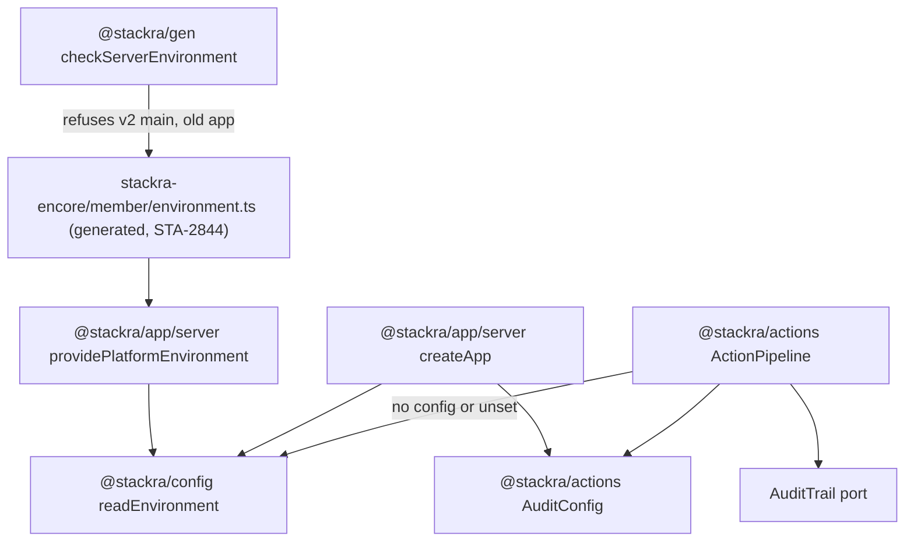

# Implementation Plan: actions, gen: an action fails closed when no AuditTrail is bound in a deployed environment

**Spec**: `.agents/specs/sta-1571-audit-fail-closed/spec.md` · **Linear**: STA-1571 · **Date**: 2026-11-27

**Input**: Feature specification from `.agents/specs/sta-1571-audit-fail-closed/spec.md`

## Summary

The action pipeline treats a missing `AuditTrail` the way it treats a missing `AccessControl`: in a deployed
environment it is an error before any step runs. The environment comes from STA-2844's one reader and nowhere else:
`AuditConfig` (`actions.audit`) holds it as one of the five Stackra environments, read from `STACKRA_ENVIRONMENT` in the
runtime only, with no default; unset, or with no `AuditConfig` bound, the pipeline asks `readEnvironment` itself. Gen
binds `AuditConfig` where actions run, refuses a v2 service that would boot `@stackra/app` without the generated
`environment.ts`, and refuses an `@stackra/app` too old to load that file.

## Technical Context

- **Language**: TypeScript (ESM), Node 24 (`mise.toml`)
- **Members**: `packages/application/actions` (application tier), `packages/developer/gen` (developer tooling)
- **Testing**: vitest in `src/**/__tests__/` (ADR 0022); gen's golden fixtures in `packages/developer/gen/__golden__/`
- **Storage**: none
- **Runtime target**: the Encore app generated by `stackra gen` (ADR 0124) and the libraries it hosts

## Key trade-off and research

- **Trade-off: ask the reader at call time when no config names the environment**, rather than keep the first
  version's exemption for an unbound `AuditConfig`. It costs one `readEnvironment` call per unaudited action outside a
  generated server (none on a generated server, whose `AuditConfig` always names it), and closes the stale-wiring and
  hand-built-resolver gaps.
- **Trade-off: refuse the v2 shape in gen** rather than change the reader's rule for a process with no platform
  (STA-2844 AC-003, approved). A v2 service gets no generated server entry or `environment.ts`, so gen is the one place
  that sees it before it deploys.
- **Research**: `read-environment.function.ts`, `is-deployed-environment.function.ts`, `create-app.function.ts` and
  `provide-platform-environment.function.ts` on `origin/main` (STA-2844); `emit-encore-environment.function.ts`;
  `discover-member.function.ts` (`authoredMain`); the `@stackra/app` release tags; `.changeset/config.json` (`fixed`).

## Applicable standards

| Rule                                                        | How it is enforced                                         |
| ----------------------------------------------------------- | ---------------------------------------------------------- |
| Every action audited, fail closed (ADR 0212 d1, d4)         | check: `action-pipeline.audit.test.ts`                     |
| The environment from the runtime only (ADR 0296 2026-11-26) | check: `audit.config.test.ts` (a value is refused)         |
| A refusal carries its fix (ADR 0294 d22)                    | check: `check-server-environment.function.test.ts`         |
| A package ships its own `X$` schema (ADR 0294 d26)          | check: `audit.config.test.ts`, `index.test.ts` export list |
| Tests beside their subjects in `__tests__/` (ADR 0022)      | check: the repository layout in CI                         |
| Generated output is pinned (gen goldens)                    | check: `golden.test.ts`                                    |

## Constitution Check

| Law                                   | Result | Note                                                                                 |
| ------------------------------------- | ------ | ------------------------------------------------------------------------------------ |
| Boundaries (tier direction, ADR 0003) | PASS   | actions imports `@stackra/config`, already a dependency; gen imports nothing new     |
| Secrets (ADR 0009)                    | N/A    | no secret is read or added                                                           |
| Security                              | PASS   | audit fails closed; the error names no input value                                   |
| HTTP and events                       | N/A    | no route or event changes                                                            |
| Tenancy                               | N/A    | no tenant data or scope change                                                       |
| Delegation                            | PASS   | Claude builds; the leader approves the plan                                          |
| Not built yet (ADR 0011)              | N/A    | nothing references an unbuilt member                                                 |
| Test placement (ADR 0022)             | PASS   | tests in `__tests__/`                                                                |
| Versions and catalogs                 | PASS   | minor for actions and gen (new refusals), patch for gen's binding; no new dependency |
| Deploy modes (ADR 0076)               | PASS   | same in all three                                                                    |
| Licence tier (ADR 0077)               | PASS   | free, MIT                                                                            |
| Docs and ADRs                         | PASS   | ADR 0212 note, `customers/security.mdx`, two READMEs                                 |

## Deploy modes

| Mode       | Behaviour                                                                                             |
| ---------- | ----------------------------------------------------------------------------------------------------- |
| SaaS       | Encore Cloud reports a deployed environment: the reader derives it, a trail is required               |
| On-prem    | a self-hosted image with infra metadata is derived; without it, it must set the variable or fail boot |
| Air-gapped | the same as on-prem; nothing calls out                                                                |

## Correctness properties

- **P-001**: in a deployed environment, no command action reaches the access check or its handler without a bound `AuditTrail` — Validates: FR-001
- **P-002**: the pipeline exempts a call from the trail only when the bound config or the one reader answers `dev` or `test` — Validates: FR-002, FR-005
- **P-003**: `AuditConfig.environment` is unset or one of `StackraEnvironment`, never a configuration value — Validates: FR-003
- **P-004**: queries are never refused for a missing trail — Validates: FR-004
- **P-005**: a service's wiring binds `AuditConfig` exactly when it declares or hosts an action — Validates: FR-006
- **P-006**: no generated service runs `@stackra/app` without loading `environment.ts` first — Validates: FR-007
- **P-007**: gen never writes an `environment.ts` for an `@stackra/app` that cannot load it, and never asks for a newer app than itself — Validates: FR-008

## Architecture overview

The generated Encore program reports where it runs; the one reader turns that into the running environment; the
configuration carries it to the pipeline, which asks the reader itself when no configuration names it.



## Components and responsibilities

Two components, one per package: the pipeline's check (C1) and the generated wiring with its refusals (C2).

### C1 Audit check in the action pipeline

**Responsibility**: refuse a command action with no `AuditTrail` in a deployed environment · **Location**:
`packages/application/actions/src/`

```text
packages/application/actions/
├── stackra.manifest.json                                         (changed: actions.audit row, STACKRA_ENVIRONMENT enum)
├── README.md                                                     (changed)
└── src/
    ├── config/audit.config.ts                                    (new)
    ├── config/__tests__/audit.config.test.ts                     (new)
    ├── core/constants/audit-config-schema.constant.ts            (new)
    ├── core/schemas/audit-options.schema.ts                      (new)
    ├── core/index.ts                                             (changed: three exports)
    ├── core/__tests__/index.test.ts                              (changed)
    ├── core/services/action-pipeline.service.ts                  (changed: trail(), environment())
    └── core/services/__tests__/action-pipeline.audit.test.ts     (new)
```

```ts
/** The audit step's settings; `environment` comes from STACKRA_ENVIRONMENT, runtime only. */
export class AuditOptions extends Schema {
  environment?: StackraEnvironment; // no default
}
/** Config key `actions.audit`; env { environment: "STACKRA_ENVIRONMENT" }. */
export class AuditConfig extends Config({ schema: AuditOptions, env: { environment: "STACKRA_ENVIRONMENT" } }) {}
/** Exported as `AuditConfig$`. */
export const AUDIT_CONFIG_SCHEMA: z.ZodObject<{ environment: z.ZodExactOptional<z.ZodEnum<...>> }>;
// ActionPipeline (private):
/** @throws Error "AuditTrail is not bound in <environment>: ..."; ConfigInvalidError from the reader */
private trail(): AuditTrail | undefined;
/** The bound AuditConfig's environment, else readEnvironment(process.env). */
private environment(): StackraEnvironment;
```

**Behaviour**: `audited` returns `work()` for a query; otherwise `trail()` reads the bound `AuditTrail`; with none, it
takes `environment()` and throws when `isDeployedEnvironment` is true.

**Failure modes**: no `AuditTrail` in a deployed environment → the call rejects before the access check, no handler
runs, nothing is written; a misspelt runtime variable → `ConfigInvalidError`, the same.

### C2 Generated wiring and gen refusals

**Responsibility**: bind `AuditConfig` where actions run, and refuse a service that could boot a deployment as `dev` ·
**Location**: `packages/developer/gen/src/`

```text
packages/developer/gen/
├── README.md                                                     (changed)
├── __golden__/pipeline-ports/                                    (changed: AuditConfig row)
└── src/
    ├── core/constants/app-environment-floor.constant.ts          (new)
    ├── core/constants/gen-reached-ports.constant.ts              (changed: AuditConfig)
    ├── core/functions/check-server-environment.function.ts       (new)
    ├── core/functions/runs-server-app.function.ts                (new)
    ├── core/functions/emit-encore-environment.function.ts        (changed: uses runsServerApp)
    ├── core/functions/generate-member.function.ts                (changed: the check, generatorVersion option)
    ├── core/functions/pipeline-ports.function.ts                 (changed)
    ├── core/functions/__tests__/check-server-environment.function.test.ts (new)
    ├── core/functions/__tests__/pipeline-ports.function.test.ts  (changed)
    ├── node/functions/generator-version.function.ts              (new)
    ├── node/functions/generate.function.ts                       (changed: passes generatorVersion)
    ├── node/functions/__tests__/generator-version.function.test.ts (new)
    ├── node/functions/__tests__/generate.function.test.ts        (changed: the v2 refusal)
    └── node/__tests__/golden.test.ts                             (changed)
```

```ts
export const APP_ENVIRONMENT_FLOOR = "0.34.0";
/** authored_main_environment, app_version_floor */
export function checkServerEnvironment(ir: MemberIR, generatorVersion?: string): GenError[];
export function runsServerApp(ir: MemberIR): boolean;
/** gen's own version, from the nearest @stackra/gen package.json; undefined when bundled elsewhere */
export function generatorVersion(from?: string): string | undefined;
/** Now also AuditConfig (from @stackra/actions) when the service declares or hosts an action. */
export function pipelinePorts(ir: MemberIR): TokenRef[];
```

**Behaviour**: a service that runs `@stackra/app` with `authoredMain` is refused; otherwise its installed
`@stackra/app` manifest version is compared with `min(APP_ENVIRONMENT_FLOOR, generatorVersion)`; a missing manifest is
left to `generated_dependency_missing`.

**Failure modes**: either refusal stops the full run with no file written; the manifest pass is unaffected.

## Files and folders

The two component trees above, plus:

```text
.changeset/actions-audit-fails-closed.md                          (new, @stackra/actions minor)
.changeset/gen-binds-audit-config.md                              (new, @stackra/gen patch)
.changeset/gen-server-environment-refusals.md                     (new, @stackra/gen minor)
apps/docs/src/docs/adr/0212-audit-evidence-access-logs-hash-chain-and-retention.mdx (changed: dated note)
apps/docs/src/docs/customers/security.mdx                         (changed)
```

Removed again by the rework, so the PR leaves them as they are on `origin/main` (the first version of #1095 added or
changed them; the STA-2844 reader replaces them):

```text
packages/application/actions/src/core/constants/unaudited-environments.constant.ts (removed: isDeployedEnvironment)
packages/runtime/app/README.md                                    (restored to origin/main)
packages/runtime/app/src/server/constants/runtime-environment-host.constant.ts (removed: PLATFORM_ENVIRONMENT_HOST)
packages/runtime/app/src/server/functions/provide-runtime-environment.function.ts (removed: providePlatformEnvironment)
packages/runtime/app/src/server/functions/running-environment.function.ts (removed: readEnvironment)
packages/runtime/app/src/server/types/runtime-environment.type.ts (removed: PlatformEnvironment)
```

## Data models and migrations

none

## Contracts

- `@stackra/actions`: new exports `AuditConfig`, `AuditConfig$`, `AuditOptions`; manifest config row
  `{ key: "actions.audit", class: "AuditConfig" }` and env row `STACKRA_ENVIRONMENT` (optional, enum of the five
  environments, field `environment`). `ActionPipeline.execute` rejects with `Error("AuditTrail is not bound in
<environment>: bind an AuditTrail driver ...")` for a command action in a deployed environment with no trail, and with
  `ConfigInvalidError` when the runtime variable is misspelt and no config names the environment.
- `@stackra/gen`: refusals `authored_main_environment` (file `src/main.ts`) and `app_version_floor` (file
  `package.json`, subject `@stackra/app`); `generateMember` accepts `generatorVersion`.

## Error handling

- Missing trail in a deployed environment: a plain `Error` with the message above, raised before any step, so no
  partial write and no audit gap. It names the drivers to bind (`outbox` of `@stackra/actions`, `postgres` of
  `@stackra/access-log`).
- A misspelt or empty `STACKRA_ENVIRONMENT`, or a value for it: `ConfigInvalidError` at boot (`AuditConfig$`, the
  reader, `buildConfig`'s runtime-only rule).
- Gen: each refusal carries its fix (convert the v2 service; upgrade `@stackra/app`).

## Security and tenancy

The change closes an audit gap: no deployed command action runs without evidence (ADR 0212 decisions 1 and 4), and no
configuration value, typo, stale wiring or authored entry can make a deployment read as `dev`. No tenant data,
permission or secret is involved; error messages carry no input value.

## Testing strategy

- AC-001, AC-002, AC-003, AC-004, AC-006: `packages/application/actions/src/core/services/__tests__/action-pipeline.audit.test.ts`
  (refused in production, staging and preview with 0 handler runs and 0 access checks; the reader decides when the
  field is unset or no config is bound; a misspelt runtime variable fails; a query is answered; with a trail, success
  and refusal entries). Revert check: with `environment()` reverted to the old exemption, the no-config and
  unset-field tests fail.
- AC-005: `packages/application/actions/src/config/__tests__/audit.config.test.ts`.
- AC-007: `pipeline-ports.function.test.ts` and the pipeline-ports golden.
- AC-008, AC-009: `check-server-environment.function.test.ts`, `generator-version.function.test.ts` and the v2 case of
  `generate.function.test.ts` (fails with the check dropped from `generateMember`).
- Exports: `index.test.ts` of `@stackra/actions`.

## Rollout

Changesets: `@stackra/actions` minor, `@stackra/gen` minor and patch. A service picks the change up when it upgrades
`@stackra/*` together and runs `stackra gen`; even before regenerating, the pipeline asks the reader, so bind an
`AuditTrail` driver before deploying the upgraded packages.

## Delegation and risk plan

Claude only; one pull request (#1095); routes `package` and `gen`. R2.

## ADRs

ADR 0212 (decisions 1 and 4), with a dated note; ADR 0296's 2026-11-26 amendment (STA-2844); no new ADR.

## Docs

ADR 0212 note, `customers/security.mdx`, the actions and gen READMEs.

## Complexity tracking

none
