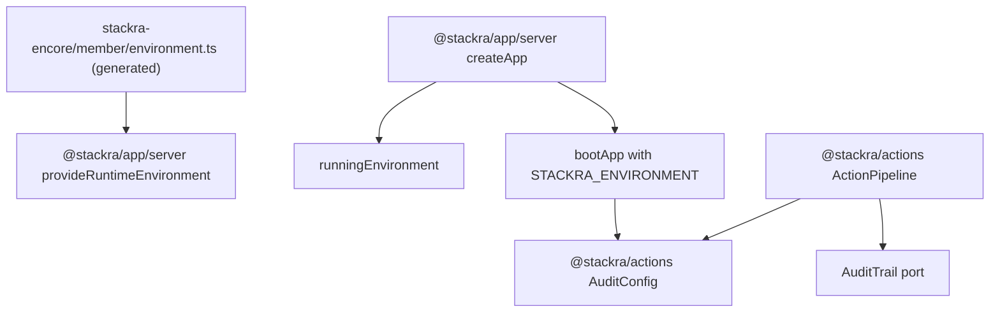

# Implementation Plan: actions, app, gen: an action fails closed when no AuditTrail is bound outside dev and test

**Spec**: `.agents/specs/sta-1571-audit-fail-closed/spec.md` · **Linear**: STA-1571 · **Date**: 2026-11-26

**Input**: Feature specification from `.agents/specs/sta-1571-audit-fail-closed/spec.md`

## Summary

The action pipeline treats a missing `AuditTrail` the way it treats a missing `AccessControl`: outside `dev` and
`test` it is an error before any step runs. The environment is a new config class, `AuditConfig` (`actions.audit`),
read from `STACKRA_ENVIRONMENT`. So that a deployment cannot read as `dev` by leaving the variable unset, gen writes an
Encore `environment.ts` that hands `appMeta().environment` to `@stackra/app/server`, and the server `createApp` derives
the variable from it, refusing `dev`, `test` or empty on a deployed runtime.

## Technical Context

- **Language**: TypeScript (ESM), Node 24 (`mise.toml`)
- **Members**: `packages/application/actions` (application tier), `packages/runtime/app` (runtime tier),
  `packages/developer/gen` (developer tooling)
- **Testing**: vitest in `src/**/__tests__/` (ADR 0022); gen's golden fixtures in `packages/developer/gen/__golden__/`
- **Storage**: none
- **Runtime target**: the Encore app generated by `stackra gen` (ADR 0124) and the libraries it hosts

## Key trade-off and research

- **Trade-off: derive the environment from the runtime**, not require operators to set `STACKRA_ENVIRONMENT`. Encore
  Cloud has no plain environment variables, so a required variable could not be set there; deriving it from
  `appMeta().environment` costs one generated file per service and a module-level value in `@stackra/app`.
- **Research**: `action-pipeline.service.ts` (the `AccessControl` fail-closed precedent and `audited`),
  `create-app.function.ts`, gen's `encoreDatabaseImport` (the existing first-import pattern of STA-1652), Encore
  1.58.8 run locally (cloud `local` for `encore run` and `encore test`), ADR 0212, ADR 0170 decision 5.

## Applicable standards

| Rule                                                   | How it is enforced                                           |
| ------------------------------------------------------ | ------------------------------------------------------------ |
| Every action audited, fail closed (ADR 0212 d1, d4)    | check: `action-pipeline.audit.test.ts`                       |
| Encore only in the generated program (ADR 0124)        | check: `@stackra/app` typechecks with no `encore.dev` import |
| A package ships its own `X$` schema (ADR 0294 d26)     | check: `audit.config.test.ts`, `index.test.ts` export list   |
| Tests beside their subjects in `__tests__/` (ADR 0022) | check: the repository layout in CI                           |
| Generated output is pinned (gen goldens)               | check: `golden.test.ts`                                      |

## Constitution Check

| Law                                   | Result | Note                                                                   |
| ------------------------------------- | ------ | ---------------------------------------------------------------------- |
| Boundaries (tier direction, ADR 0003) | PASS   | no new cross-tier import; gen names `@stackra/app` only in output text |
| Secrets (ADR 0009)                    | N/A    | no secret is read or added                                             |
| Security                              | PASS   | audit fails closed; the error names no input value                     |
| HTTP and events                       | N/A    | no route or event changes                                              |
| Tenancy                               | N/A    | no tenant data or scope change                                         |
| Delegation                            | PASS   | Claude builds; the leader approves the plan                            |
| Not built yet (ADR 0011)              | N/A    | nothing references an unbuilt member                                   |
| Test placement (ADR 0022)             | PASS   | tests in `__tests__/`                                                  |
| Versions and catalogs                 | PASS   | minor for actions and app, patch for gen; no new dependency            |
| Deploy modes (ADR 0076)               | PASS   | same in all three                                                      |
| Licence tier (ADR 0077)               | PASS   | free, MIT                                                              |
| Docs and ADRs                         | PASS   | ADR 0212 note, `customers/security.mdx`, three READMEs                 |

## Deploy modes

| Mode       | Behaviour                                                                                          |
| ---------- | -------------------------------------------------------------------------------------------------- |
| SaaS       | Encore Cloud runtime is deployed: environment derived, a trail is required                         |
| On-prem    | a self-hosted image that declares its cloud is deployed: the same; one left at `local` reads `dev` |
| Air-gapped | the same as on-prem; nothing calls out                                                             |

## Correctness properties

- **P-001**: outside `dev` and `test`, no command action reaches the access check or its handler without a bound `AuditTrail` — Validates: FR-001
- **P-002**: with `dev`, `test` or no `AuditConfig`, the pipeline behaves as before the change — Validates: FR-002
- **P-003**: `AuditConfig.environment` is never empty after boot and defaults to `dev` — Validates: FR-003
- **P-004**: queries are never refused for a missing trail — Validates: FR-004
- **P-005**: a deployed runtime's running environment is one of `preview`, `staging`, `production` or a name the variable sets, never `dev`, `test` or empty — Validates: FR-005, FR-006
- **P-006**: every generated Encore file of a service with a server entry loads `environment.ts` before the server app — Validates: FR-007
- **P-007**: a service's wiring binds `AuditConfig` exactly when it declares or hosts an action — Validates: FR-008

## Architecture overview

The generated Encore program provides where it runs; the server app turns that into the running environment; the
configuration carries it to the pipeline, which refuses an unaudited action outside `dev` and `test`.



## Components and responsibilities

Three components, one per package: the pipeline's check (C1), the environment's derivation (C2), and the generated
wiring that connects them (C3).

### C1 Audit check in the action pipeline

**Responsibility**: refuse a command action with no `AuditTrail` outside `dev` and `test` · **Location**:
`packages/application/actions/src/`

```text
packages/application/actions/
├── stackra.manifest.json                                         (changed: actions.audit row, STACKRA_ENVIRONMENT)
├── README.md                                                     (changed)
└── src/
    ├── config/audit.config.ts                                    (new)
    ├── config/__tests__/audit.config.test.ts                     (new)
    ├── core/constants/audit-config-schema.constant.ts            (new)
    ├── core/constants/unaudited-environments.constant.ts         (new)
    ├── core/schemas/audit-options.schema.ts                      (new)
    ├── core/index.ts                                             (changed: three exports)
    ├── core/__tests__/index.test.ts                              (changed)
    ├── core/services/action-pipeline.service.ts                  (changed: trail())
    └── core/services/__tests__/action-pipeline.audit.test.ts     (new)
```

```ts
/** The audit step's settings; `environment` comes from STACKRA_ENVIRONMENT. */
export class AuditOptions extends Schema {
  environment: string; // default "dev"
}
/** Config key `actions.audit`; env { environment: "STACKRA_ENVIRONMENT" }. */
export class AuditConfig extends Config({ schema: AuditOptions, env: { environment: "STACKRA_ENVIRONMENT" } }) {}
/** Exported as `AuditConfig$`; an empty name fails boot. */
export const AUDIT_CONFIG_SCHEMA: z.ZodObject<{ environment: z.ZodDefault<z.ZodString> }>;
/** Internal: the environments that may run an action unaudited. */
export const UNAUDITED_ENVIRONMENTS: readonly string[]; // ["dev", "test"]
// ActionPipeline (private):
/** @throws Error "AuditTrail is not bound in <environment>: ..." when no trail is bound outside dev and test */
private trail(): AuditTrail | undefined;
```

**Behaviour**: `audited` returns `work()` for a query; otherwise `trail()` reads the bound `AuditTrail`; with none, it
reads the bound `AuditConfig`; no config or `dev` / `test` gives `undefined` (no entry); any other name throws.

**Failure modes**: no `AuditTrail` outside `dev` and `test` → the call rejects before the access check, no handler
runs, nothing is written.

### C2 Running environment in the server app

**Responsibility**: derive `STACKRA_ENVIRONMENT` from the serving runtime and refuse `dev` or `test` when deployed ·
**Location**: `packages/runtime/app/src/server/`

```text
packages/runtime/app/
├── README.md                                                     (changed)
└── src/server/
    ├── constants/runtime-environment-host.constant.ts            (new)
    ├── functions/provide-runtime-environment.function.ts         (new)
    ├── functions/running-environment.function.ts                 (new)
    ├── functions/create-app.function.ts                          (changed)
    ├── functions/__tests__/running-environment.function.test.ts  (new)
    ├── functions/__tests__/create-app.environment.test.ts        (new)
    ├── types/runtime-environment.type.ts                         (new)
    ├── index.ts                                                  (changed: three exports)
    └── __tests__/index.test.ts                                   (changed)
```

```ts
export interface RuntimeEnvironment {
  readonly name: string;
  readonly type: string; // production | development | ephemeral | test
  readonly cloud: string; // "local" only on a developer machine or a local test run
}
/** Stores where the runtime runs, for createApp. */
export function provideRuntimeEnvironment(runtime: RuntimeEnvironment): void;
/** @throws ConfigInvalidError when a deployed runtime names dev, test or nothing */
export function runningEnvironment(
  runtime: RuntimeEnvironment | undefined,
  raw: Readonly<Record<string, string | undefined>>,
): string | undefined;
/** @throws ConfigInvalidError (as a rejection) also when a deployed runtime names dev or test */
export function createApp(root: ModuleClass, options: ServerAppOptions): Promise<ServerApp>;
```

**Behaviour**: no runtime → the variable as is; `cloud === "local"` → the variable, else `test` for type test, else
`dev`; deployed with the variable set → it, unless `dev`, `test` or empty (throw); deployed with none → the name when
`preview`, `staging` or `production`, else by type (`production`, `ephemeral` → `preview`, other → `staging`).
`createApp` passes `{ ...process.env, STACKRA_ENVIRONMENT: environment }` to boot when it is defined.

**Failure modes**: a forbidden name on a deployed runtime → boot rejects and the process exits before serving.

### C3 Generated Encore environment and wiring

**Responsibility**: write `environment.ts`, import it first, and bind `AuditConfig` where actions run · **Location**:
`packages/developer/gen/src/core/`

```text
packages/developer/gen/
├── README.md                                                     (changed)
├── __golden__/*/expected/services/*/stackra-encore/*/            (changed: environment.ts.golden new, first import)
└── src/
    ├── core/constants/gen-reached-ports.constant.ts              (changed: AuditConfig)
    ├── core/functions/emit-encore-environment.function.ts        (new)
    ├── core/functions/encore-setup-imports.function.ts           (new)
    ├── core/functions/emit-encore-{api,cron-jobs,events,http,inbox,queues}.function.ts (changed)
    ├── core/functions/generate-member.function.ts                (changed)
    ├── core/functions/pipeline-ports.function.ts                 (changed)
    ├── core/functions/__tests__/emit-encore-environment.function.test.ts (new)
    ├── core/functions/__tests__/encore-setup-imports.function.test.ts    (new)
    ├── core/functions/__tests__/pipeline-ports.function.test.ts          (changed)
    ├── core/functions/__tests__/generate-member.function.test.ts         (changed)
    ├── core/functions/__tests__/emit-encore-cron-jobs.function.test.ts   (changed)
    └── node/__tests__/golden.test.ts                             (changed)
```

```ts
/** stackra-encore/<member>/environment.ts, or undefined for a package, an app or an authored-main service. */
export function emitEncoreEnvironment(ir: MemberIR): GeneratedFile | undefined;
/** ['import "./environment";', 'import "./database";'], each only when its file is written. */
export function encoreSetupImports(ir: MemberIR): string[];
/** Now also AuditConfig (from @stackra/actions) when the service declares or hosts an action. */
export function pipelinePorts(ir: MemberIR): TokenRef[];
```

**Behaviour**: the generated file is two imports and one call,
`provideRuntimeEnvironment(appMeta().environment)`. The seven Encore emitters call `encoreSetupImports` where they
called `encoreDatabaseImport`.

**Failure modes**: a `@stackra/app` older than the matching minor → the generated program fails to compile on the
missing export (loud).

## Files and folders

The three component trees above, plus:

```text
.changeset/actions-audit-fails-closed.md                          (new, @stackra/actions minor)
.changeset/app-running-environment.md                             (new, @stackra/app minor)
.changeset/gen-binds-audit-config.md                              (new, @stackra/gen patch)
.changeset/gen-encore-environment.md                              (new, @stackra/gen patch)
apps/docs/src/docs/adr/0212-audit-evidence-access-logs-hash-chain-and-retention.mdx (changed: dated note)
apps/docs/src/docs/customers/security.mdx                         (changed)
packages/developer/gen/__golden__/pipeline-ports/input/_modules/@stackra/actions/stackra.manifest.json.golden (changed)
packages/developer/gen/__golden__/pipeline-ports/expected/services/shop/.stackra/gen/wiring.ts.golden (changed)
```

## Data models and migrations

none

## Contracts

- `@stackra/actions`: new exports `AuditConfig`, `AuditConfig$`, `AuditOptions`; manifest config row
  `{ key: "actions.audit", class: "AuditConfig" }` and env row `STACKRA_ENVIRONMENT` (optional, string, field
  `environment`). `ActionPipeline.execute` rejects with `Error("AuditTrail is not bound in <environment>: bind an
AuditTrail driver ...")` for a command action outside `dev` and `test` with no trail.
- `@stackra/app/server`: new exports `provideRuntimeEnvironment`, `runningEnvironment`, type `RuntimeEnvironment`;
  `createApp` may now reject with `ConfigInvalidError` (path `STACKRA_ENVIRONMENT`).
- `@stackra/gen`: new generated file `stackra-encore/<member>/environment.ts`; `import "./environment";` first in
  `api.ts`, `cron.ts`, `http.ts`, `subscriptions.ts`, `inbox.ts`, `queues.ts` and the events files.

## Error handling

- Missing trail outside `dev` and `test`: a plain `Error` with the message above, raised before any step, so no
  partial write and no audit gap. It names the drivers to bind (`outbox` of `@stackra/actions`, `postgres` of
  `@stackra/access-log`).
- Forbidden environment on a deployed runtime: `ConfigInvalidError("env", [{ path: "STACKRA_ENVIRONMENT", ... }])`,
  boot rejects.
- Empty `STACKRA_ENVIRONMENT`: refused by `AuditConfig$` (`z.string().min(1)`) at boot.

## Security and tenancy

The change closes an audit gap: no deployed command action runs without evidence (ADR 0212 decisions 1 and 4). A
misspelt environment fails closed. No tenant data, permission or secret is involved; error messages carry no input
value.

## Testing strategy

- AC-001, AC-002, AC-003, AC-004: `packages/application/actions/src/core/services/__tests__/action-pipeline.audit.test.ts`
  (refused in production, staging, preview and `prod` with 0 handler runs and 0 access checks; unset reads as `dev`;
  no `AuditConfig` keeps the old behaviour; a query is answered; with a trail, success and refusal entries).
- AC-005: `packages/application/actions/src/config/__tests__/audit.config.test.ts`.
- AC-006, AC-007: `packages/runtime/app/src/server/functions/__tests__/create-app.environment.test.ts` (fails on the
  commit before the change) and `running-environment.function.test.ts`.
- AC-008: `packages/runtime/app/src/server/functions/__tests__/running-environment.function.test.ts`.
- AC-009: `emit-encore-environment.function.test.ts`, `encore-setup-imports.function.test.ts` and the goldens
  (`golden.test.ts`).
- AC-010: `pipeline-ports.function.test.ts`.
- Exports: `index.test.ts` of `@stackra/actions` and of `@stackra/app/server`.

## Rollout

Changesets: `@stackra/actions` minor, `@stackra/app` minor, `@stackra/gen` patch (two). A service picks the change up
when it upgrades the three and runs `stackra gen`; before that its wiring binds no `AuditConfig` and nothing changes.
Bind an `AuditTrail` driver before deploying the regenerated service.

## Delegation and risk plan

Claude only; one pull request (#1095); routes `package` and `gen`. R2.

## ADRs

ADR 0212 (decisions 1 and 4), with a dated note; no new ADR.

## Docs

ADR 0212 note, `customers/security.mdx`, the actions, app and gen READMEs.

## Complexity tracking

none
