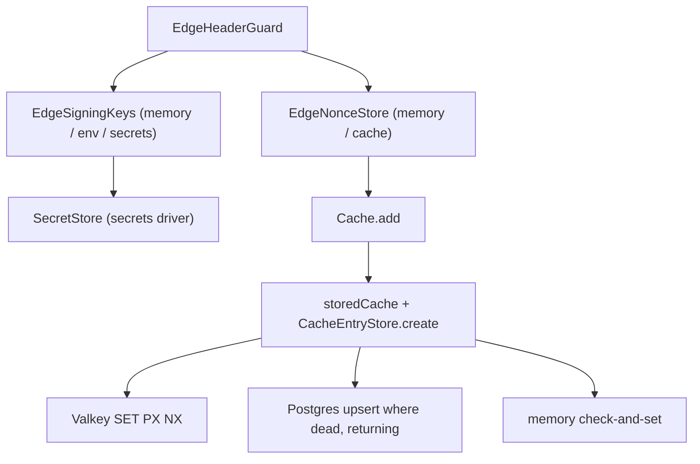
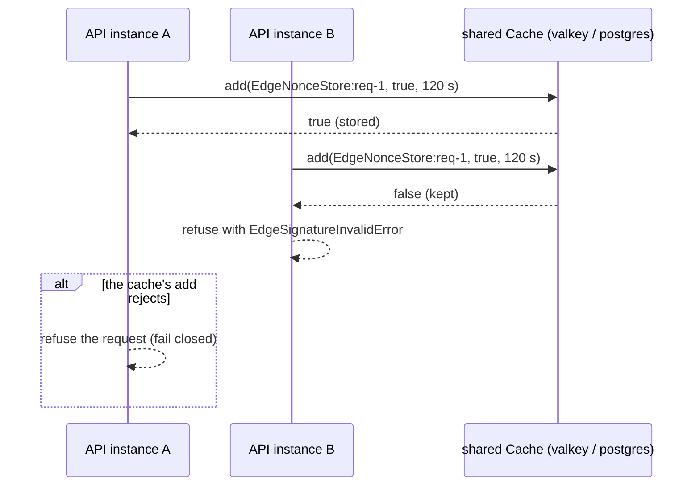

# Implementation Plan: a shared edge nonce store over `Cache.add`, and secret-store edge signing keys

**Spec**: `.agents/specs/sta-2803-edge-shared-nonce-store/spec.md` · **Linear**: STA-2803 · **Date**: 2026-11-26

**Input**: Feature specification from `.agents/specs/sta-2803-edge-shared-nonce-store/spec.md`

## Summary

`Cache` gains `add`, an atomic set-if-absent with an exact lifetime, built on the stores that have one (memory,
Valkey `SET NX`, a Postgres upsert that replaces only a dead row) and rejecting elsewhere. `EdgeNonceStore` gains a
`cache` driver that claims request ids with it, so every instance sharing the cache refuses a replay. `EdgeSigningKeys`
gains a `secrets` driver that reads the keys by name from the bound `SecretStore` on each check.

## Technical Context

- **Language**: TypeScript (ESM), Node 24 (`mise.toml`)
- **Members**: `packages/runtime/cache` (runtime), `packages/runtime/app` (runtime), `packages/data/database` (test only), `apps/docs` (ADR 0437)
- **Testing**: vitest in `src/**/__tests__/` (ADR 0022); integration tests `*.int.test.ts` on Testcontainers Valkey and Postgres
- **Storage**: none new (the existing unlogged cache tables of migration 0005)
- **Runtime target**: libraries; drivers selected by config through the wiring gen writes (ADR 0263)

## Key trade-off and research

- **Trade-off: the nonce store rides on `Cache`** instead of a dedicated nonce table or Valkey client in
  `@stackra/app`: no second connection or migration, and every deployment already binds a cache. The cost is that a
  claim is a cache entry: it is indexed in the namespace's sets (extra sorted-set round trips on Valkey), and a
  `flush()` of the shared namespace drops live claims. A driver whose store cannot set-if-absent rejects instead of
  faking it, so a misconfiguration fails closed rather than open.
- **Research**: ADR 0437 decision 4 and its Enforcement list; ADR 0150 (cache drivers, namespaces, tags);
  `storedCache` and the three `CacheEntryStore` shapes; Valkey `SET` with `NX` and `PX`; Postgres
  `insert … on conflict … do update … where … returning` under the row lock; `bootApp`'s binding of
  `envSecrets(options.env)` as the `SecretStore` in every shipped target.

## Applicable standards

| Rule                                                   | How it is enforced                                                   |
| ------------------------------------------------------ | -------------------------------------------------------------------- |
| Raw SQL is parameterised (ADR 0160)                    | check: `postgres-cache.driver.test.ts` "binds every value"           |
| Secrets by name, never a value (ADR 0173, ADR 0525)    | check: the `signingKeysSecret` regex in `EDGE_CONFIG_SCHEMA`; review |
| Tests beside their subjects in `__tests__/` (ADR 0022) | check: the repository layout in CI                                   |
| `memory` first, one option one driver (ADR 0266)       | check: `edge-options` defaults test; review                          |
| Barrel exports exactly its values                      | check: `src/server/__tests__/index.test.ts`                          |
| Changesets for publishable packages                    | check: changeset status in CI                                        |

## Constitution Check

| Law                                   | Result | Note                                                                   |
| ------------------------------------- | ------ | ---------------------------------------------------------------------- |
| Boundaries (tier direction, ADR 0003) | PASS   | `@stackra/app` (runtime) imports `@stackra/cache` (runtime); same tier |
| Secrets (ADR 0009)                    | PASS   | secrets read by name from `SecretStore`; no value in code or config    |
| Security                              | PASS   | both new drivers fail closed; claims hold `true`, never request data   |
| HTTP and events                       | PASS   | no route or event added                                                |
| Tenancy                               | N/A    | no tenant-owned data; claims sit in the shared namespace before a call |
| Delegation                            | PASS   | R3 work: not delegated to OpenCode; independent review                 |
| Not built yet (ADR 0011)              | PASS   | no rejected or deferred technology used                                |
| Test placement (ADR 0022)             | PASS   | every test in `__tests__/` beside its subject                          |
| Versions and catalogs                 | PASS   | `testcontainers` from the catalog; `@stackra/cache` as `workspace:*`   |
| Deploy modes (ADR 0076)               | PASS   | Valkey and Postgres run in all three modes                             |
| Licence tier (ADR 0077)               | PASS   | free, MIT                                                              |
| Docs and ADRs                         | PASS   | ADR 0437 Enforcement updated; READMEs and AGENTS.md updated            |

## Deploy modes

| Mode       | Behaviour                                                                                          |
| ---------- | -------------------------------------------------------------------------------------------------- |
| SaaS       | a region with more than one API instance sets `app.edge.nonces: cache` over `valkey` or `postgres` |
| On-prem    | same; the operator's Valkey or Postgres is the shared store                                        |
| Air-gapped | same; no outbound call is added                                                                    |

## Correctness properties

- **P-001**: for any key, of N concurrent `add` calls on a shared store exactly one answers true — Validates: FR-002, FR-005
- **P-002**: a claim made on one instance makes every other instance's claim of the same id answer false until the lifetime ends, then true — Validates: FR-001, FR-002
- **P-003**: a driver without an atomic set-if-absent never answers `add`; it rejects, and the guard refuses — Validates: FR-003, FR-004, FR-006
- **P-004**: an added value lives exactly `ttl`, whatever the cache's jitter — Validates: FR-005
- **P-005**: `env` and `secrets` answer the same key list for the same text, and `secrets` follows the store's current value — Validates: FR-007, FR-008, FR-009
- **P-006**: with no config, both edge ports resolve to `memory`, and the manifests list every driver name in `EDGE_DRIVERS` — Validates: FR-010

## Architecture overview

`EdgeHeaderGuard` verifies the signature with `EdgeSigningKeys.active()`, then calls `EdgeNonceStore.claim`. With
`nonces: cache`, the claim goes to `Cache.add` on the bound cache driver, whose store answers the set-if-absent in one
atomic step. With `keys: secrets`, `active()` reads the named secret from the bound `SecretStore`.





## Components and responsibilities

The work divides into the cache's set-if-absent (C1), the edge nonce driver over it (C2), and the secret-store signing
keys driver with its shared parser (C3).

### C1 `Cache.add`

**Responsibility**: an atomic set-if-absent with an exact lifetime on every cache store that has one ·
**Location**: `packages/runtime/cache`

```text
packages/runtime/cache/
├── src/contracts/ports/cache.port.ts                       (changed: add, rejecting default)
├── src/core/types/cache-store.type.ts                      (changed: optional create)
├── src/core/types/cache-entry-store.type.ts                (changed: optional create)
├── src/core/types/cache-operations.type.ts                 (changed: optional add)
├── src/core/functions/stored-cache.function.ts             (changed: add over create)
├── src/core/functions/memory-entry-store.function.ts       (changed: create)
├── src/core/functions/text-entry-store.function.ts         (changed: create passes through)
├── src/core/drivers/stored-cache.driver.ts                 (changed: add delegates or rejects)
├── src/core/drivers/memory-cache.driver.ts                 (docs)
├── src/core/drivers/storage-cache.driver.ts                (docs: add rejects)
├── src/node/drivers/valkey-cache.driver.ts                 (changed: create = SET PX NX)
├── src/node/drivers/postgres-cache.driver.ts               (changed: create = upsert where dead)
├── src/worker/drivers/workers-cache.driver.ts              (docs: add rejects)
├── src/node/drivers/__tests__/valkey-cache.driver.int.test.ts (new)
└── vitest.int.config.ts                                    (new)
```

```ts
export abstract class Cache extends Port {
  /**
   * Stores `value` under `key` for exactly `ttl` only when nothing is kept under `key`; answers whether it stored.
   * Atomic across every instance sharing the store. A zero `ttl` stores nothing and answers false.
   * @throws {TypeError} by default, naming the driver, when the store has no atomic set-if-absent
   */
  add<T>(key: CacheKey, value: T, ttl: Duration): Promise<boolean>;
}

export interface CacheStore {
  /** Stores `text` under `key` for exactly `ttl` only when nothing is kept, in one atomic step. */
  create?: (key: string, text: string, ttl: Duration) => Promise<boolean>;
}
```

**Behaviour**: `storedCache` defines `add` only when the entry store has `create`: write the index sets first (as
`write` does) when the store cannot list keys, then `create` the entry with `expiresAt = now + ttl`, and on success drop
any `remember` load in flight for the key so it does not overwrite the added value.

**Failure modes**: the store errors → `add` rejects and nothing is assumed stored; the store has no `create` → the port
default rejects with a `TypeError`.

### C2 `CacheEdgeNonceStoreDriver`

**Responsibility**: claim edge request ids in the shared cache · **Location**: `packages/runtime/app/src/server/drivers/`

```text
packages/runtime/app/
├── src/server/drivers/cache-edge-nonce-store.driver.ts                 (new)
├── src/server/drivers/__tests__/cache-edge-nonce-store.driver.test.ts  (new)
├── src/server/__tests__/edge-nonce-shared.int.test.ts                  (new)
├── src/contracts/ports/edge-nonce-store.port.ts                        (docs)
└── src/server/services/edge-header.guard.ts                            (docs)
```

```ts
export class CacheEdgeNonceStoreDriver extends Driver(EdgeNonceStore) {
  constructor(cache: Cache);
  /** True for the first claim of `nonce` across every instance; false while an earlier claim is live. Rejects when the cache cannot add. */
  claim(nonce: string, ttlSeconds: number): Promise<boolean>;
}
```

**Behaviour**: `cache.add(CacheKey.of(EdgeNonceStore, nonce), true, Duration.seconds(ttlSeconds))`.

**Failure modes**: the cache rejects → the claim rejects → the guard refuses the request.

### C3 `SecretsEdgeSigningKeysDriver` and `edgeSigningKeysOf`

**Responsibility**: answer the active signing keys from the bound `SecretStore` by name · **Location**:
`packages/runtime/app/src/server/`

```text
packages/runtime/app/
├── src/server/drivers/secrets-edge-signing-keys.driver.ts                 (new)
├── src/server/drivers/__tests__/secrets-edge-signing-keys.driver.test.ts  (new)
├── src/server/drivers/env-edge-signing-keys.driver.ts                     (changed: uses edgeSigningKeysOf)
├── src/contracts/ports/edge-signing-keys.port.ts                          (docs: names the secrets driver)
├── src/server/functions/edge-signing-keys-of.function.ts                  (new)
├── src/server/__tests__/edge-signing-keys-boot.test.ts                    (new)
├── src/core/constants/edge-config-schema.constant.ts                      (changed: signingKeysSecret)
├── src/core/constants/edge-drivers.constant.ts                            (changed: secrets, cache)
├── src/core/schemas/edge-options.schema.ts                                (changed: signingKeysSecret)
├── src/core/types/edge-driver-names.type.ts                               (changed: names)
├── src/server/index.ts                                                    (changed: two exports)
└── stackra.manifest.json                                                  (changed: candidates)
```

```ts
export function edgeSigningKeysOf(text: string | undefined): readonly string[];

export class SecretsEdgeSigningKeysDriver extends Driver(EdgeSigningKeys) {
  constructor(secrets: SecretStore, config: EdgeConfig);
  /** The keys the store holds now, newest first; rejects when the store throws. */
  active(): Promise<readonly string[]>;
}

// EdgeConfig (EDGE_CONFIG_SCHEMA)
signingKeysSecret: string; // SCREAMING_SNAKE, default "STACKRA_EDGE_SIGNING_KEYS"
```

**Behaviour**: `edgeSigningKeysOf(secrets.get(config.signingKeysSecret))` on every call.

**Failure modes**: the store throws → `active()` rejects → the guard refuses; the secret is unset → no key → every
signed request is refused.

### C4 Package wiring, manifests and docs

**Responsibility**: the dependency, test script, generated manifest copy and documentation of the change ·
**Location**: the two packages, `workers/edge` and `apps/docs`

```text
packages/runtime/app/
├── package.json                                  (changed: @stackra/cache dependency)
├── README.md                                     (changed: the cache and secrets drivers, rotation order)
└── AGENTS.md                                     (changed: the same, for agents)
packages/runtime/cache/
├── package.json                                  (changed: test:int script, testcontainers dev dependency)
├── README.md                                     (changed: add)
└── AGENTS.md                                     (changed: add)
workers/edge/
└── stackra.manifest.json                         (changed: generated drivers list)
apps/docs/src/docs/adr/
└── 0437-the-edge-worker-its-kv-copy-and-the-server-checks.mdx (changed: Enforcement list)
```

```ts
// runway config of a region with more than one API instance behind the edge
const config = {
  cache: { driver: "valkey" }, // or "postgres": a store every instance shares
  app: { edge: { keys: "env", nonces: "cache" } }, // keys: "secrets" reads the SecretStore by name
};
```

**Behaviour**: none at runtime; wiring and documentation only.

**Failure modes**: none.

## Files and folders

The trees of C1 to C3, plus: `packages/runtime/app/package.json` (`@stackra/cache` dependency),
`packages/runtime/cache/package.json` (`test:int`, `testcontainers`), `workers/edge/stackra.manifest.json` (generated
copy of the drivers), `packages/data/database/src/node/database/migrations/__tests__/0005-create-cache-tables.migration.int.test.ts`,
the READMEs and AGENTS.md of both packages, ADR 0437, `.changeset/edge-shared-nonce-store.md` and `pnpm-lock.yaml`.

## Data models and migrations

none (the Postgres `add` writes the existing unlogged `cache_entries` table of migration 0005; no schema change)

## Contracts

- `@stackra/cache/contracts`: `Cache.add<T>(key, value, ttl): Promise<boolean>`, additive with a rejecting default, so
  a third-party `Cache` driver compiles unchanged and rejects `add` until it implements it.
- `@stackra/app/server`: new exports `CacheEdgeNonceStoreDriver`, `SecretsEdgeSigningKeysDriver`.
- Config: `app.edge.nonces` accepts `cache`; `app.edge.keys` accepts `secrets`; new `app.edge.signingKeysSecret`.
- Driver registry keys `app.EdgeNonceStore` and `app.EdgeSigningKeys` widen; both manifests list the new candidates.
- Compatibility: every default stays `memory`; existing callers and configs behave as before. Minor bumps for
  `@stackra/cache` and `@stackra/app`.

## Error handling

`Cache.add` on a store without set-if-absent rejects with a `TypeError` naming the driver. A rejected claim or a
throwing `SecretStore` makes `EdgeHeaderGuard` refuse with its one `EdgeSignatureInvalidError`; nothing is let through
on a failure.

## Security and tenancy

Fail-closed on every failure path; signing keys are read by secret name and never logged, kept or returned past the
guard; a claim stores `true`, never request data. Claims live in the namespace current when the guard runs (before any
call starts, the shared one), so they are not tenant data. Today `bootApp` binds the boot environment as the
`SecretStore` in every shipped target, so `secrets` answers the same keys as `env` and a rotation still needs a restart
(STA-2804).

## Testing strategy

- AC-001, AC-003: `edge-header.guard.test.ts` (second instance refuses a replay over a shared cache; a memory store per
  instance lets it through; a cache with no atomic add lets nothing through) and `edge-nonce-shared.int.test.ts` on
  real Postgres.
- AC-002, AC-005: `memory-cache.driver.test.ts`, `valkey-cache.driver.int.test.ts` (Testcontainers),
  `postgres-cache.driver.test.ts` and the cache-tables migration integration test (dead row replaced, live row kept).
- AC-004: `cache.port.test.ts`, `storage-cache.driver.test.ts`, `workers-cache.driver.test.ts`.
- AC-006, AC-007: `secrets-edge-signing-keys.driver.test.ts`, `edge-signing-keys-boot.test.ts`.
- AC-008: `src/server/__tests__/index.test.ts` and the manifest check.

## Rollout

Publish `@stackra/cache` and `@stackra/app` (minor). A region with more than one API instance sets
`app.edge.nonces: cache` over a shared `valkey` or `postgres` cache before its edge goes live. A key rotation lists
both keys, restarts every API instance, then switches the Worker to the new key.

## Partial-failure ordering

`@stackra/cache` must publish with or before `@stackra/app` (the app imports `Cache.add`); the changeset bumps both in
one release. Config switches to `cache` only after the shared cache is bound; reverting the config to `memory` undoes it.

## Delegation and risk plan

R3: Claude only, one wave, independent security review before merge; no OpenCode delegation.

## ADRs

ADR 0437 (Accepted; Enforcement list updated by this change), ADR 0150, ADR 0160, ADR 0173, ADR 0263, ADR 0266,
ADR 0294, ADR 0525.

## Docs

ADR 0437; `packages/runtime/app/README.md` and `AGENTS.md`; `packages/runtime/cache/README.md` and `AGENTS.md`.

## Complexity tracking

none

## Open questions

None.
