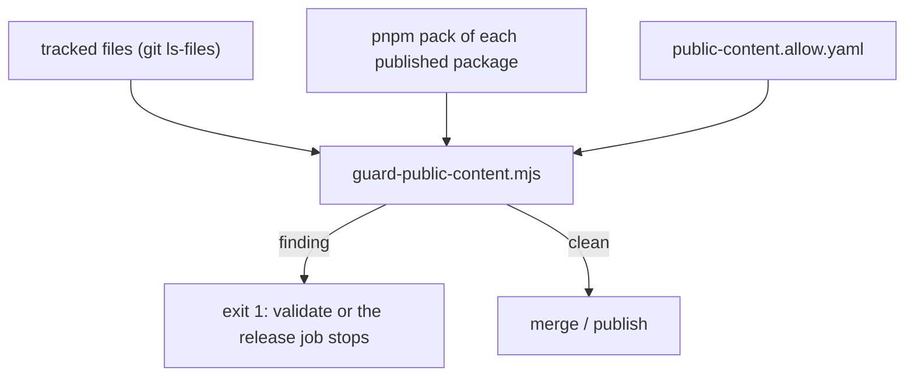

# Implementation Plan: public repos and packages carry nothing internal

**Spec**: `.agents/specs/sta-2876-scrub-internal-content/spec.md` · **Linear**: STA-2876 · **Date**: 2026-11-27

**Input**: Feature specification from `.agents/specs/sta-2876-scrub-internal-content/spec.md`

## Summary

Every tracked file outside the CLI and the applied registry migrations is rewritten with neutral examples (acme,
bistro, `dev.example`, `/Users/me`) or neutral prose ("the academy product", "the dev zone"). Two pieces of behaviour
named internal infrastructure and become inputs: the pull-request preview zone (`pullRequestZone` in the root runway)
and the testbed's key pair (`keyPair`), and the testbed workflow reads its state bucket from the assumed account. A new
guard, `tools/scripts/guard-public-content.mjs`, keeps it so: its test reads the whole repository in `pnpm validate`,
and both release paths read every tarball before publishing.

## Technical Context

- **Language**: TypeScript (ESM) and Node scripts (`.mjs`), Node 24 (`mise.toml`); GitHub Actions YAML
- **Members**: packages/developer/runway, packages/infrastructure/infra-testbed (behaviour); the other touched members (examples and prose); tools/scripts; .github/workflows; apps/docs
- **Testing**: vitest in `src/**/__tests__/` (ADR 0022); `node --test tools/scripts/__tests__/*.test.mjs` (in `pnpm validate`)
- **Storage**: none
- **Runtime target**: libraries, CI scripts and workflows

## Key trade-off and research

- **Trade-off: hashes, not a word list.** A plain list of forbidden names in a public file would publish them. The
  guard keeps SHA-256 hashes with each term's length (so most words are skipped unhashed) and a reason. The cost: a
  reader cannot see what is denied, and a new term needs `--hash`. Substring matching is not possible on hashes, so
  hosts are checked by each dotted suffix and words whole.
- **Trade-off: a required zone over a default.** The old default zone was Figentra's own; any neutral default would
  publish previews under a domain the product does not own. A pull-request publish without the zone is refused.
- **Research**: the 0.33.1 tarballs from the Stackra registry; `pnpm pack --pack-destination` and the beforePacking
  hook; GNU tar long names; `actions/create-github-app-token`'s comma or newline `repositories`.

## Applicable standards

| Rule                                                   | How it is enforced                                             |
| ------------------------------------------------------ | -------------------------------------------------------------- |
| No internal content in tracked files                   | check: `guard-public-content.test.mjs` in `pnpm validate`      |
| No internal content in tarballs                        | check: the tarball steps in `runway-npm.yml` and `release.yml` |
| No secret-shaped strings                               | check: gitleaks (lefthook, `pnpm secrets:scan`), unchanged     |
| Tests beside their subjects in `__tests__/` (ADR 0022) | check: the repository layout in CI                             |
| Workflows lint clean                                   | check: actionlint and zizmor in the Quality Gate               |
| Changesets for publishable packages                    | check: changeset status in CI                                  |

## Constitution Check

| Law                                   | Result | Note                                                               |
| ------------------------------------- | ------ | ------------------------------------------------------------------ |
| Boundaries (tier direction, ADR 0003) | PASS   | no new import                                                      |
| Secrets (ADR 0009)                    | PASS   | no secret read or named; two variables hold names                  |
| Security                              | PASS   | personal and infrastructure data removed from public files         |
| HTTP and events                       | N/A    | no route or event                                                  |
| Tenancy                               | N/A    | no tenant data                                                     |
| Delegation                            | PASS   | not delegated                                                      |
| Not built yet (ADR 0011)              | PASS   | no rejected or deferred technology used                            |
| Test placement (ADR 0022)             | PASS   | every test in `__tests__/`                                         |
| Versions and catalogs                 | PASS   | no dependency added                                                |
| Deploy modes (ADR 0076)               | PASS   | same in all three                                                  |
| Licence tier (ADR 0077)               | PASS   | free, MIT                                                          |
| Docs and ADRs                         | PASS   | runbooks, READMEs updated; ADR prose scrubbed, decisions unchanged |

## Deploy modes

| Mode       | Behaviour                                                    |
| ---------- | ------------------------------------------------------------ |
| SaaS       | a product that publishes pull-request previews sets its zone |
| On-prem    | same                                                         |
| Air-gapped | same; the guard reads local files only                       |

## Correctness properties

- **P-001**: for any tracked file outside the allow list, the guard finds every whole denied word, every denied host suffix and every non-placeholder home folder in its path and text — Validates: FR-001, FR-002, FR-003
- **P-002**: the guard's source holds no denied term — Validates: FR-003, NFR-002
- **P-003**: a tarball is read file by file under its full path; an allowed package is skipped and no other — Validates: FR-004, FR-005
- **P-004**: no package is published unless its tarball passed the guard in the same job — Validates: FR-006
- **P-005**: a pull-request host is `<product>-pr-<n>.<zone>` for the product's own zone, and no zone means no publish — Validates: FR-008
- **P-006**: the launch template names the stack's key pair when given, else the default — Validates: FR-009
- **P-007**: an exempt line or path (an approval line, the CLI, an applied migration, a legacy spec) is byte-for-byte as on `origin/main` — Validates: FR-007
- **P-008**: the reconcile's repo list is the public list plus `--extra-repos`, each once, and `--repos` alone replaces it — Validates: FR-010
- **P-009**: the ported rules name the porter's own checkouts from the environment, never a fixed person's path — Validates: FR-011

## Architecture overview



## Components and responsibilities

The work divides into the guard (C1), its release wiring (C2), the inputs that replace internal names (C3) and the
text scrub (C4).

### C1 The guard

**Responsibility**: find internal names, hosts, account ids and home folders in tracked files and tarballs ·
**Location**: `tools/scripts`

```text
tools/scripts/
├── guard-public-content.mjs                    (new)
├── public-content.allow.yaml                   (new)
├── README.md                                   (changed)
└── __tests__/guard-public-content.test.mjs     (new)
```

```ts
export const DENIED: Map<string, { length: number; reason: string }>; // SHA-256 of the lower-case term
export function lineFindings(line: string): string[];
export function scanText(path: string, text: string, allow?: AllowEntry[]): Finding[];
export function tarballFiles(bytes: Buffer): [string, string][];
export function scanTarball(label: string, bytes: Buffer, allow?: AllowEntry[]): Finding[];
```

**Behaviour**: words whole, hosts by each suffix, home folders unless a placeholder; the path is line 0.

**Failure modes**: a finding exits 1; bad usage exits 2; `git ls-files` failing throws.

### C2 Release wiring

**Responsibility**: read every tarball before it is published · **Location**: `.github/workflows`

```text
.github/workflows/
├── runway-npm.yml      (changed: input pack-check, step "Tarball check")
├── release.yml         (changed: passes the guard; prerelease "Tarball check")
└── README.md           (changed)
```

```ts
// runway-npm.yml, workflow_call input (YAML shown as its TypeScript shape)
type RunwayNpmInputs = {
  /** A command run with every tarball that would be published as its last arguments; "" runs no check. */
  "pack-check"?: string; // release.yml: "node tools/scripts/guard-public-content.mjs --pack"
};
```

**Behaviour**: `pnpm pack --pack-destination` for every package with `"private"` not true (or the prerelease
selection), then the check with every tarball as arguments.

**Failure modes**: no tarball packed, or a finding: the job stops; nothing is published.

### C3 Inputs instead of internal names

**Responsibility**: the preview zone, the testbed key pair, the reconcile's private repos and the port's checkouts
come from the product or the environment · **Location**: runway, infra-testbed, tools/scripts, workflows

```text
packages/developer/runway/
├── src/core/constants/root-environment-schema.constant.ts       (changed: pullRequestZone)
├── schema/root.json                                             (changed)
├── src/node/constants/pull-request-preview-settings.constant.ts (changed: no zone)
├── src/node/functions/pull-request-preview-host.function.ts     (changed: zone argument)
├── src/node/functions/publish-pull-request.function.ts          (changed: reads and requires the zone)
├── src/node/functions/__tests__/publish-pull-request.function.test.ts (changed)
└── README.md                                                    (changed)
tools/schemas/runway-root.schema.json                            (changed)
packages/infrastructure/infra-testbed/
├── src/core/constants/testbed-defaults.constant.ts              (changed: neutral defaults)
├── src/node/types/aws-testbed-options.type.ts                   (changed: keyPair)
├── src/node/functions/aws-testbed.function.ts                   (changed: options.keyPair)
├── src/node/functions/__tests__/aws-testbed.function.test.ts    (changed)
├── pulumi/main.mjs                                              (changed: keyPair)
└── pulumi/Pulumi.yaml                                           (changed: keyPair)
tools/scripts/
├── linear-reconcile.mjs                                         (changed: --extra-repos)
├── linear-reconcile.repos.yaml                                  (changed: public repos only)
├── guard-port.mjs                                               (changed: environment paths)
└── __tests__/
    ├── linear-reconcile.test.mjs                                (changed)
    └── guard-port.test.mjs                                      (changed)
.github/workflows/
├── apply-testbed.yml                                            (changed: KEY_PAIR, state bucket from the account)
└── linear-sync.yml                                              (changed: LINEAR_RECONCILE_EXTRA_REPOS)
```

```ts
export function pullRequestPreviewHost(product: string, pullRequest: number, zone: string): string;
// root runway: environments.preview.domains.pullRequestZone?: string
export type AwsTestbedOptions = { /* … */ readonly keyPair?: string };
export function readRepos(argv: string[], text: string): { org: string; repos: string[] }; // --repos | --extra-repos
// guard-port.mjs: process.env.GUARD_PORT_STACKRA ?? ~/Projects/stackra; process.env.GUARD_PORT_MUSLIN_REFERENCE
```

**Behaviour**: as FR-008 to FR-011.

**Failure modes**: a pull-request publish without the zone is refused (`RunwayInvalidError`); a muslin port without its
reference exits 2.

### C4 The scrub

**Responsibility**: neutral examples and prose everywhere else · **Location**: the members in Impact

```text
apps/docs/src/config/                        (changed: a comment)
apps/docs/src/docs/                          (changed: prose)
apps/mobile/src/constants/                   (changed: the demo theme's constant)
apps/mobile/src/constants/brand-themes/      (changed: the demo theme renamed)
apps/playground/                             (changed: openapi.json and stackra.manifest.json examples)
apps/playground/src/constants/brand-themes/  (changed: the demo theme renamed)
apps/playground/src/demos/                   (changed: demo data)
apps/playground/src/styles/                  (changed: the demo theme's fonts)
apps/playground/public/fonts/                (changed: the demo theme's font folder renamed)
.agents/                                     (changed: prose, never an approval line or a spec older than ADR 0502)
packages/application/achievements/           (changed: ORIGIN.md)
packages/application/ai/                     (changed: doc comments)
packages/commerce/fiscal/                    (changed: examples)
packages/commerce/payments/                  (changed: examples)
packages/commerce/pricing/                   (changed: examples)
packages/design-system/tokens/               (changed: a token note)
packages/design-system/ui/                   (changed: doc comments)
packages/developer/gen/                      (changed: examples)
packages/developer/runway/                   (changed: examples, besides C3)
packages/developer/vite-plugin/              (changed: examples)
packages/experience/native-scale/            (changed: examples)
packages/experience/panel/                   (changed: examples)
packages/foundation/support/                 (changed: doc comments)
packages/infrastructure/infra-aws-runtime/   (changed: examples)
packages/infrastructure/infra-cloudflare/    (changed: examples, hosts and tunnel names)
packages/infrastructure/infra-github/        (changed: README)
packages/infrastructure/infra-testbed/       (changed: besides C3, the changelog)
packages/runtime/app/                        (changed: the changelog)
packages/developer/cli/                      (unchanged: STA-2790)
workers/registry/                            (changed: README, a test; migrations unchanged)
pnpm-workspace.yaml                          (changed: a comment)
```

```ts
// no interface: examples and prose only, for instance
pullRequestPreviewHost("bistro", 412, "preview.example"); // "bistro-pr-412.preview.example"
```

**Behaviour**: text only. **Failure modes**: none.

## Files and folders

The trees of C1 to C4, plus `.changeset/public-content-scrub.md`, the touched members' tests and changelogs
(`packages/runtime/app/CHANGELOG.md`, `packages/infrastructure/infra-testbed/CHANGELOG.md`,
`packages/developer/runway/CHANGELOG.md`) and `apps/docs/src/docs/runbooks/release.mdx`, `runway.mdx`.

## Data models and migrations

none

## Contracts

- `@stackra/runway/node` (breaking, minor in 0.x): `pullRequestPreviewHost(product, pullRequest, zone)`;
  `PULL_REQUEST_PREVIEW_SETTINGS` without `zone`; root runway `environments.preview.domains.pullRequestZone`, required
  for a pull-request publish.
- `@stackra/infra-testbed` (additive): `AwsTestbedOptions.keyPair`; `TESTBED_DEFAULTS` values change.
- `runway-npm.yml` (additive): input `pack-check`, empty by default.
- `linear-reconcile.mjs` (additive): `--extra-repos`.

## Error handling

The guard prints every finding as `path:line: reason` and exits 1. A pull-request publish without its zone answers
`RunwayInvalidError` naming `environments.preview.domains.pullRequestZone`; a bad zone throws `TypeError`.

## Security and tenancy

Removes personal data and infrastructure names from public files; the denied terms live only as hashes. No tenant data
is touched.

## Testing strategy

- AC-001, AC-003: `guard-public-content.test.mjs` (the whole repository; path, word, host, home folder, approval lines).
- AC-002, AC-004: `--pack` over 119 packed tarballs on the build box; the test's tarball cases.
- AC-005: `publish-pull-request.function.test.ts`. AC-006: `aws-testbed.function.test.ts`.
- AC-007: `linear-reconcile.test.mjs`. AC-008: `guard-port.test.mjs`. AC-009: the diff against `origin/main`.

## Rollout

Merge; the next release publishes clean tarballs. Before the next testbed apply the owner sets `TESTBED_KEY_PAIR` to the
existing pair (the workflow refuses without it); for the nightly reconcile to keep reading private repos,
`LINEAR_RECONCILE_EXTRA_REPOS`. Approvers write role-only approval lines (STA-2905).
A product that publishes pull-request previews adds `pullRequestZone` before its next pull request.
