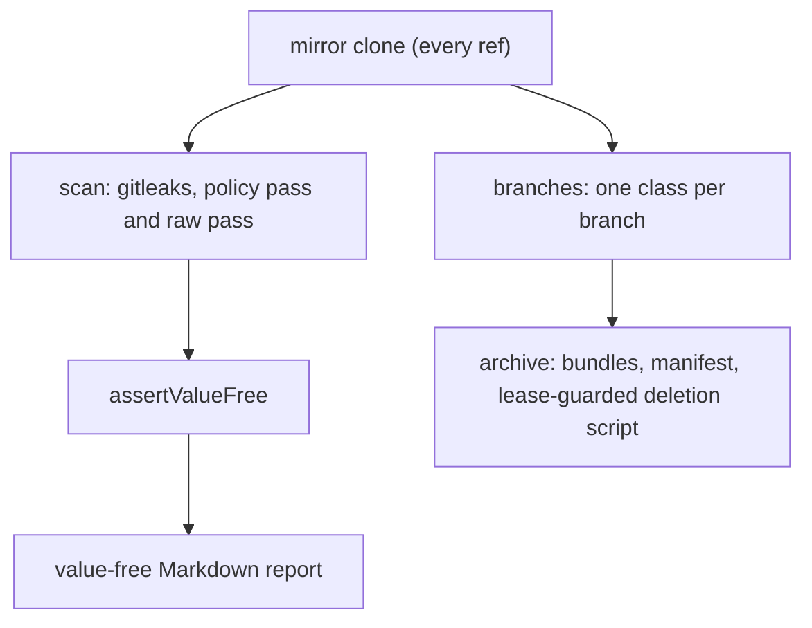

# Implementation Plan: a full-history secret scan of every public ref and a stale-branch archive plan

**Spec**: `.agents/specs/sta-2878-history-secret-scan/spec.md` · **Linear**: STA-2878 · **Date**: 2026-11-26

**Input**: Feature specification from `.agents/specs/sta-2878-history-secret-scan/spec.md`

## Summary

`tools/scripts/secrets-history-scan.mjs` scans a mirror clone of a public repository with the pinned gitleaks over
every commit reachable from any ref, in two passes: the repositorys own policy, and gitleaks default rules with no
allowlist of any kind (no config allowlist, an empty ignore file and `--ignore-gitleaks-allow`). It prints a value-free
Markdown report of each finding and the refs that carry it, lists stale branches, and writes verified bundles and
lease-guarded deletion commands for the owner. Two dated reports under `docs/security/` record the 26 November run.

## Technical Context

- **Language**: JavaScript (ESM), Node 24 (`mise.toml`)
- **Members**: root `tools/scripts` and `package.json` (`secrets:scan:history`); `docs/security`
- **Testing**: `node --test tools/scripts/__tests__/secrets-history-scan.test.mjs`, with a fake gitleaks for the
  value-handling cases and the real gitleaks 8.30.1 for the ref-coverage and inline-allow cases
- **Storage**: none
- **Runtime target**: a developer and CI tool, not shipped

## Key trade-off and research

- **Trade-off: two passes instead of one.** The policy pass answers "would CI block this?"; the raw pass answers "is
  anything token-shaped anywhere in the public history?". Only the raw pass ignores inline `gitleaks:allow` comments,
  because the policy honours them; without that flag a token marked allowed on an unreviewed branch, tag or pull
  request ref would never be seen.
- **Research**: gitleaks 8.30.1 `git --help` (`--log-opts`, `--redact`, `--gitleaks-ignore-path`,
  `--ignore-gitleaks-allow`); GitHub keeps `refs/pull/*/head` public after a branch is deleted; ADR 0009, ADR 0267.

## Applicable standards

| Rule                                       | How it is enforced                                                         |
| ------------------------------------------ | -------------------------------------------------------------------------- |
| No secret value in output (ADR 0009, 0267) | check: `assertValueFree` and the "scan refuses, printing nothing" test     |
| Pinned tools (ADR 0019, ADR 0027)          | check: gitleaks version read and printed; `mise.toml` pins 8.30.1          |
| Raw pass ignores inline allow comments     | check: the fake gitleaks exits 9 on the wrong flag; the real-gitleaks test |
| Nothing deleted or pushed by the tool      | check: the archive tests compare every ref before and after                |

## Constitution Check

| Law                                   | Result | Note                                                         |
| ------------------------------------- | ------ | ------------------------------------------------------------ |
| Boundaries (tier direction, ADR 0003) | N/A    | root tool script, no package                                 |
| Secrets (ADR 0009)                    | PASS   | value-free output, checked before printing                   |
| Security                              | PASS   | read-only; deletion is an owner step guarded by a lease      |
| HTTP and events                       | N/A    | none                                                         |
| Tenancy                               | N/A    | none                                                         |
| Not built yet (ADR 0011)              | PASS   | no new technology                                            |
| Test placement (ADR 0022)             | PASS   | `tools/scripts/__tests__/`                                   |
| Versions and catalogs                 | PASS   | no new dependency                                            |
| Deploy modes (ADR 0076)               | N/A    | not shipped                                                  |
| Licence tier (ADR 0077)               | PASS   | free, MIT                                                    |
| Docs and ADRs                         | PASS   | two dated reports under `docs/security/`; scripts README row |

## Deploy modes

| Mode       | Behaviour                                                    |
| ---------- | ------------------------------------------------------------ |
| SaaS       | none: a developer and CI tool over a repository, not shipped |
| On-prem    | same                                                         |
| Air-gapped | same; it reads a local mirror clone only                     |

## Correctness properties

- **P-001**: every commit reachable from any ref of the mirror (branch, tag, `refs/pull/*`) is read by both passes — Validates: FR-001
- **P-002**: a finding only the raw pass reports is listed as `allowlisted`, and an inline `gitleaks:allow` hides nothing from the raw pass — Validates: FR-002
- **P-003**: no byte of a matched value appears in any output; output that would carry one is refused whole — Validates: FR-003
- **P-004**: every branch gets exactly one class, and a protected branch is never listed for archiving — Validates: FR-004
- **P-005**: `archive` leaves every ref as it found it, and each deletion command deletes only a branch still at its archived tip — Validates: FR-005

## Architecture overview



## Components and responsibilities

One component: `tools/scripts/secrets-history-scan.mjs` (commands `scan`, `branches`, `archive`). It reads a local
mirror clone and the pinned gitleaks, and writes only the report, the bundles, the manifest and the deletion script it
is asked for.

## Files and folders

```text
tools/scripts/secrets-history-scan.mjs                    (new)
tools/scripts/__tests__/secrets-history-scan.test.mjs     (new)
tools/scripts/README.md                                   (a row)
package.json                                              (script secrets:scan:history)
docs/security/history-secret-scan-2026-11-26.md           (the report)
docs/security/branch-archive-plan-2026-11-26.md           (the archive plan)
```

## Data models and migrations

none

## Contracts

- `pnpm secrets:scan:history scan <mirror>`, `branches <mirror>`, `archive <mirror> <out> <branch>…`; exit 0 done, 1 a
  refusal (a matched value would be printed), 2 usage.
- The report rows: file, line, commit, rule, policy result, placeholder or review, on `main` or not, and the refs.

## Error handling

A bad command line exits 2 with the usage and never echoes it. Output that would carry a matched value is refused
whole: nothing is printed. `archive` refuses a protected branch or a name that is not a plain ref before writing.

## Security and tenancy

The tool never prints a matched value (checked before printing), deletes nothing and pushes nothing; the deletion
script is an owner step guarded by `--force-with-lease`. Pull request refs can only be removed by GitHub Support
(STA-2922). No tenant data.

## Testing strategy

- AC-001 to AC-011: `tools/scripts/__tests__/secrets-history-scan.test.mjs`, one named test per criterion (the
  Acceptance criteria section names each); AC-006 and AC-007 run the real gitleaks 8.30.1.
- P-001 to P-005: the same tests; each guard has a revert check (removing it fails a test).

## Rollout

Nothing deploys. The owner runs the archive plan and turns on GitHub secret scanning and push protection; the pull
request refs are a GitHub Support request (STA-2922).
