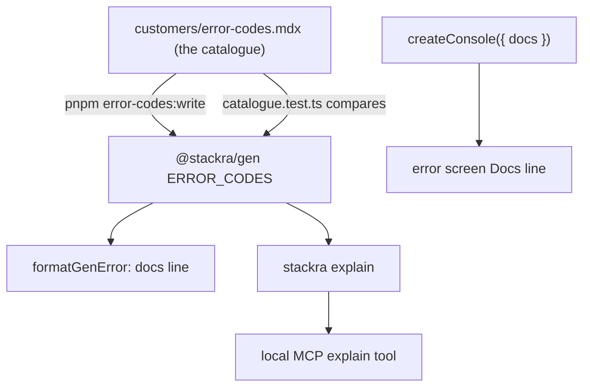

# Implementation Plan: `stackra explain <code>`, and a docs link on every gen and command error

**Spec**: `.agents/specs/sta-2891-stackra-explain/spec.md` · **Linear**: STA-2891 · **Date**: 2026-11-27

**Input**: Feature specification from `.agents/specs/sta-2891-stackra-explain/spec.md`

## Summary

The error-code reference page (STA-2853) stays the one catalogue. A writer in apps/docs copies its rows, with the
site's heading id of each row's group, into `@stackra/gen`'s `ERROR_CODES`. Gen prints a docs line from it on every
finding, `stackra explain` prints a row (and is the MCP's `explain` tool), and the console links every other error to
the troubleshooting page. A test fails when the copy and the page differ or a code has no row.

## Technical Context

- **Language**: TypeScript (ESM), Node 24 (`mise.toml`)
- **Members**: `packages/developer/gen`, `packages/developer/cli`, `packages/developer/console`, `apps/docs`
- **Testing**: vitest in `__tests__/` beside each subject (ADR 0022)
- **Storage**: none
- **Runtime target**: the `stackra` binary and its local MCP

## Key trade-off and research

- **Trade-off: the page is the source, the code holds a copy** instead of the rows living in code and the page being
  rendered from them. STA-2853's page is reviewed customer prose with its own guard; rendering it would duplicate or
  rewrite it. The cost is a written copy that must be refreshed (`pnpm error-codes:write`); the catalogue test makes a
  stale copy fail CI, so the cost is a command, never a silent drift.
- **Trade-off: the copy lives in `@stackra/gen`**, the lowest package that prints codes and that the CLI already
  depends on, so gen's docs line needs no new dependency.
- **Research**: fumadocs-core `remarkHeading` (github-slugger ids, reset per page); the console's `problemOf` and
  `toolsOf`; STA-2853's `documentedCodes` and `emittedCodes`.

## Applicable standards

| Rule                                                   | How it is enforced                                               |
| ------------------------------------------------------ | ---------------------------------------------------------------- |
| A refusal names its code and fix (ADR 0294 d22, d26)   | check: `format-gen-error.function.test.ts`                       |
| One catalogue, never two (this spec, FR-001)           | check: `apps/docs/.../catalogue.test.ts`                         |
| Tests beside their subjects in `__tests__/` (ADR 0022) | check: the repository layout in CI                               |
| Barrel exports exactly its values                      | check: `packages/developer/gen/src/core/__tests__/index.test.ts` |
| Changesets for publishable packages                    | check: changeset status in CI                                    |

## Constitution Check

| Law                                   | Result | Note                                                            |
| ------------------------------------- | ------ | --------------------------------------------------------------- |
| Boundaries (tier direction, ADR 0003) | PASS   | cli imports gen and console, as before; apps/docs imports gen   |
| Secrets (ADR 0009)                    | PASS   | none read or printed                                            |
| Security                              | PASS   | static text only; nothing typed reaches a file, process or URL  |
| HTTP and events                       | N/A    | no route or event                                               |
| Tenancy                               | N/A    | no tenant data                                                  |
| Delegation                            | PASS   | R1                                                              |
| Not built yet (ADR 0011)              | PASS   | no rejected or deferred technology                              |
| Test placement (ADR 0022)             | PASS   | every test in `__tests__/`                                      |
| Versions and catalogs                 | PASS   | no new dependency                                               |
| Deploy modes (ADR 0076)               | PASS   | offline; prints links only                                      |
| Licence tier (ADR 0077)               | PASS   | free, MIT                                                       |
| Docs and ADRs                         | PASS   | the three pages, apps/docs AGENTS.md and the CLI README updated |

## Deploy modes

| Mode       | Behaviour                                                       |
| ---------- | --------------------------------------------------------------- |
| SaaS       | the same CLI output                                             |
| On-prem    | the same; links point at the public docs site                   |
| Air-gapped | `stackra explain` works offline; the printed links need the web |

## Correctness properties

- **P-001**: for every row of the page, `ERROR_CODES` holds an equal entry, in page order — Validates: FR-001, FR-006
- **P-002**: every entry's anchor is the id the site gives its group heading — Validates: FR-002
- **P-003**: for every code gen can print, `formatGenError` links its group's section — Validates: FR-003, FR-006
- **P-004**: every console error carries a docs link: the error's, else the command's, else the console's — Validates: FR-007
- **P-005**: for every row, `stackra explain` with its code (as printed, in another case, with `-` for `_`, or as a check finding's `<tool>/<rule>`) prints the row and its section's link — Validates: FR-004, AC-001, AC-006
- **P-006**: the local MCP's tool list holds `explain`, read-only, with the command's `code` argument — Validates: FR-005
- **P-007**: a code no row lists exits 2 with at most five close codes (a `<tool>/` prefix read as its rule) and the reference as the docs link — Validates: FR-008, AC-007

## Architecture overview



## Components and responsibilities

- `ERROR_CODES`, `ERROR_CODES_PAGE`, `errorCodeEntry`, `errorCodeDocs`, `ErrorCodeEntry` (gen `core`): the copied
  catalogue and its lookups; `formatGenError` prints the docs line from it.
- The writer and guard (apps/docs `scripts/error-codes`): copy the page into `ERROR_CODES`; fail when they differ.
- `ExplainCommand`, `findErrorCode`, `closestCodes` (cli `node`): `stackra explain` and the MCP's `explain` tool.
- `ConsoleConfig.docs` (console `core`), `TROUBLESHOOTING_DOCS` (cli `node`): the fallback docs link of every error.

### C1 The catalogue copy (`packages/developer/gen`, `apps/docs/scripts/error-codes`)

The page's rows, copied by `pnpm error-codes:write` into `ERROR_CODES` with each group's site heading id; gen's docs
line and every reader of a code use it.

```text
packages/developer/gen/src/core/
├── constants/error-codes.constant.ts       (new, written)
├── constants/error-codes-page.constant.ts  (new)
├── functions/error-code-entry.function.ts  (new)
├── functions/error-code-docs.function.ts   (new)
├── functions/format-gen-error.function.ts  (changed: docs line)
└── types/error-code-entry.type.ts          (new)
apps/docs/scripts/error-codes/
├── heading-anchors.ts, catalogue-entries.ts, render-catalogue.ts, catalogue-paths.ts, write-catalogue.ts (new)
├── source-files.ts                          (changed: skips the copy)
└── __tests__/catalogue.test.ts              (new)
```

```ts
export interface ErrorCodeEntry {
  readonly code: string;
  readonly tool: "gen" | "check" | "runway";
  readonly group: string;
  readonly anchor: string;
  readonly cause: string;
  readonly fix: string;
}
export const ERROR_CODES: readonly ErrorCodeEntry[];
export const ERROR_CODES_PAGE: string;
export function errorCodeEntry(code: string): ErrorCodeEntry | undefined;
export function errorCodeDocs(code: string): string;
```

### C2 `stackra explain` (`packages/developer/cli`)

`ExplainCommand` (`commands/explain.command.ts`) finds the row with `findErrorCode`
(`explain/functions/find-error-code.function.ts`: `errorCodeEntry`, then a `stackra check` finding's `<tool>/<rule>`
read as its check rule), suggests with `closestCodes` (`explain/functions/closest-codes.function.ts`, which also reads
`<tool>/<rule>` as its rule) and is listed in `COMMANDS` and in `MCP_COMMAND`'s tools.

```text
packages/developer/cli/src/node/
├── commands/explain.command.ts                     (new)
├── explain/functions/find-error-code.function.ts   (new)
├── explain/functions/closest-codes.function.ts     (new)
├── constants/commands.constant.ts                  (changed: lists ExplainCommand)
└── constants/mcp-command.constant.ts               (changed: the explain tool)
packages/developer/cli/stackra.manifest.json        (changed: the explain command)
```

```ts
export class ExplainCommand /* Command({ name: "explain", tool: { readOnly: true }, docs: ERROR_CODES_PAGE }) */ {
  code: string;
  handle(io: CommandIo): void;
}
export function findErrorCode(typed: string): ErrorCodeEntry | undefined;
export function closestCodes(typed: string, codes: readonly string[]): string[];
```

### C3 The fallback docs link (`packages/developer/console`, `packages/developer/cli`)

`ConsoleConfig.docs`; `createConsole`'s `finish` uses the command's link, else the console's; `runCli` passes
`TROUBLESHOOTING_DOCS`.

```text
packages/developer/console/src/core/
├── types/console-config.type.ts            (changed: docs)
└── functions/create-console.function.ts    (changed: the fallback)
packages/developer/cli/src/node/
├── constants/troubleshooting-docs.constant.ts  (new)
└── functions/run-cli.function.ts               (changed: passes it)
```

```ts
export interface ConsoleConfig {
  /* … */
  readonly docs?: string;
}
export const TROUBLESHOOTING_DOCS: string;
```

## Files and folders

```text
.changeset/stackra-explain-error-codes.md
apps/docs/AGENTS.md
apps/docs/package.json
apps/docs/scripts/error-codes/__tests__/catalogue.test.ts
apps/docs/scripts/error-codes/catalogue-entries.ts
apps/docs/scripts/error-codes/catalogue-paths.ts
apps/docs/scripts/error-codes/heading-anchors.ts
apps/docs/scripts/error-codes/render-catalogue.ts
apps/docs/scripts/error-codes/source-files.ts
apps/docs/scripts/error-codes/write-catalogue.ts
apps/docs/src/docs/cli.mdx
apps/docs/src/docs/customers/error-codes.mdx
apps/docs/src/docs/customers/troubleshooting.mdx
packages/developer/cli/README.md
packages/developer/cli/src/node/commands/__tests__/explain.command.test.ts
packages/developer/cli/src/node/commands/explain.command.ts
packages/developer/cli/src/node/constants/__tests__/mcp-command.constant.test.ts
packages/developer/cli/src/node/constants/commands.constant.ts
packages/developer/cli/src/node/constants/mcp-command.constant.ts
packages/developer/cli/src/node/constants/troubleshooting-docs.constant.ts
packages/developer/cli/src/node/explain/functions/__tests__/closest-codes.function.test.ts
packages/developer/cli/src/node/explain/functions/__tests__/find-error-code.function.test.ts
packages/developer/cli/src/node/explain/functions/closest-codes.function.ts
packages/developer/cli/src/node/explain/functions/find-error-code.function.ts
packages/developer/cli/src/node/functions/__tests__/run-cli.function.test.ts
packages/developer/cli/src/node/functions/run-cli.function.ts
packages/developer/cli/stackra.manifest.json
packages/developer/console/src/core/functions/__tests__/create-console.function.test.ts
packages/developer/console/src/core/functions/create-console.function.ts
packages/developer/console/src/core/types/console-config.type.ts
packages/developer/gen/src/core/__tests__/index.test.ts
packages/developer/gen/src/core/constants/error-codes-page.constant.ts
packages/developer/gen/src/core/constants/error-codes.constant.ts
packages/developer/gen/src/core/functions/__tests__/error-code-docs.function.test.ts
packages/developer/gen/src/core/functions/__tests__/format-gen-error.function.test.ts
packages/developer/gen/src/core/functions/error-code-docs.function.ts
packages/developer/gen/src/core/functions/error-code-entry.function.ts
packages/developer/gen/src/core/functions/format-gen-error.function.ts
packages/developer/gen/src/core/index.ts
packages/developer/gen/src/core/types/error-code-entry.type.ts
```

## Data models and migrations

none

## Contracts

- `@stackra/gen`: `ERROR_CODES: readonly ErrorCodeEntry[]`, `ERROR_CODES_PAGE`, `errorCodeEntry(code)`,
  `errorCodeDocs(code)` and the type `ErrorCodeEntry` (additive exports); `formatGenError` ends with
  `  docs: <link> (stackra explain <code>)`.
- `@stackra/console`: `ConsoleConfig.docs?: string` (additive).
- `stackra explain <code> [--json]`: exit 0 with `{ code, tool, group, cause, fix, docs, rerun? }` as the data; exit 2
  (`usage`) for an unknown or missing code. Accepts a code as printed, in another case, with `-` for `_`, or a check
  finding's `<tool>/<rule>`. The local MCP's read-only `explain` tool takes `{ code }`.

## Error handling

- An unknown code: `CliUsageError` "unknown error code: <code>", exit 2, hint "Did you mean …?" with up to five codes
  (a `<tool>/` prefix is read as its rule), else a pointer to the reference; the docs link is the reference page.
- A missing code without a terminal: a usage error, exit 2; at a terminal it is asked for.
- A page heading with inline Markdown: `pnpm error-codes:write` refuses it (its site id needs the full parser).

## Security and tenancy

Static text only. The typed code is looked up in a shipped constant and echoed in a message; it never reaches a file,
a process, a URL or the network. No tenant data, secret or personal data is involved.

## Testing strategy

- AC-001, AC-006, AC-007: `explain.command.test.ts`, `find-error-code.function.test.ts`,
  `closest-codes.function.test.ts`; the built CLI on box 2 (`stackra explain repo-checks/imports --json` exits 0 with
  `imports`, `repo-checks/import` hints `imports`).
- AC-002: `format-gen-error.function.test.ts`, `error-code-docs.function.test.ts`, gen's `index.test.ts`.
- AC-003: `create-console.function.test.ts`, `run-cli.function.test.ts`.
- AC-004: `mcp-command.constant.test.ts`.
- AC-005: `catalogue.test.ts` with STA-2853's `error-codes.test.ts`.
- Revert checks: reverting `find-error-code` use in `explain.command.ts` and the prefix read in
  `closest-codes.function.ts` fails three tests (PR notes); typecheck, oxlint and oxfmt on every touched package.

## Rollout

One minor changeset for gen, cli and console. Users see the docs line and `stackra explain` after upgrading the CLI;
nothing to migrate. The page stays the source: a row change is followed by `pnpm error-codes:write`, which CI enforces.

## Delegation and risk plan

Claude only; one wave; route `spec-task`. R1: developer tooling output only.

## ADRs

none new (implements ADR 0294 decision 26 and ADR 0282 decision 5).

## Docs

The error-code, troubleshooting and CLI pages, apps/docs `AGENTS.md`, the CLI README and the changeset.

## Complexity tracking

none
