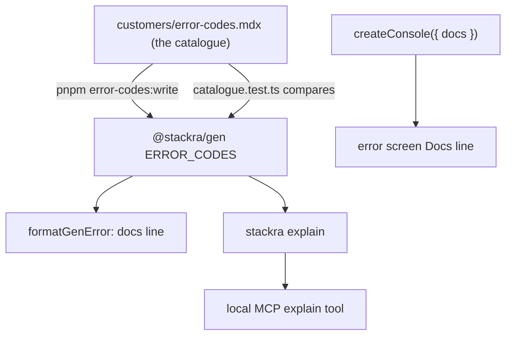

# Implementation Plan: `stackra explain <code>`, and a docs link on every gen and command error

**Spec**: `.agents/specs/sta-2891-stackra-explain/spec.md` · **Linear**: STA-2891 · **Date**: 2026-11-27

**Input**: Feature specification from `.agents/specs/sta-2891-stackra-explain/spec.md`

## Summary

The error-code reference page (STA-2853) stays the one catalogue. A writer in apps/docs copies its rows, with the
site's heading id of each row's group, into `@stackra/gen`'s `ERROR_CODES`. Gen prints a docs line from it on every
finding, `stackra explain` prints a row (and is the MCP's `explain` tool), and the console links every other error to
the troubleshooting page. A test fails when the copy and the page differ or a code has no row.

## Technical Context

- **Language**: TypeScript (ESM), Node 24 (`mise.toml`)
- **Members**: `packages/developer/gen`, `packages/developer/cli`, `packages/developer/console`, `apps/docs`
- **Testing**: vitest in `__tests__/` beside each subject (ADR 0022)
- **Storage**: none
- **Runtime target**: the `stackra` binary and its local MCP

## Key trade-off and research

- **Trade-off: the page is the source, the code holds a copy** instead of the rows living in code and the page being
  rendered from them. STA-2853's page is reviewed customer prose with its own guard; rendering it would duplicate or
  rewrite it. The cost is a written copy that must be refreshed (`pnpm error-codes:write`); the catalogue test makes a
  stale copy fail CI, so the cost is a command, never a silent drift.
- **Trade-off: the copy lives in `@stackra/gen`**, the lowest package that prints codes and that the CLI already
  depends on, so gen's docs line needs no new dependency.
- **Research**: fumadocs-core `remarkHeading` (github-slugger ids, reset per page); the console's `problemOf` and
  `toolsOf`; STA-2853's `documentedCodes` and `emittedCodes`.

## Applicable standards

| Rule                                                   | How it is enforced                                               |
| ------------------------------------------------------ | ---------------------------------------------------------------- |
| A refusal names its code and fix (ADR 0294 d22, d26)   | check: `format-gen-error.function.test.ts`                       |
| One catalogue, never two (this spec, FR-001)           | check: `apps/docs/.../catalogue.test.ts`                         |
| Tests beside their subjects in `__tests__/` (ADR 0022) | check: the repository layout in CI                               |
| Barrel exports exactly its values                      | check: `packages/developer/gen/src/core/__tests__/index.test.ts` |
| Changesets for publishable packages                    | check: changeset status in CI                                    |

## Constitution Check

| Law                                   | Result | Note                                                            |
| ------------------------------------- | ------ | --------------------------------------------------------------- |
| Boundaries (tier direction, ADR 0003) | PASS   | cli imports gen and console, as before; apps/docs imports gen   |
| Secrets (ADR 0009)                    | PASS   | none read or printed                                            |
| Security                              | PASS   | static text only; nothing typed reaches a file, process or URL  |
| HTTP and events                       | N/A    | no route or event                                               |
| Tenancy                               | N/A    | no tenant data                                                  |
| Delegation                            | PASS   | R1                                                              |
| Not built yet (ADR 0011)              | PASS   | no rejected or deferred technology                              |
| Test placement (ADR 0022)             | PASS   | every test in `__tests__/`                                      |
| Versions and catalogs                 | PASS   | no new dependency                                               |
| Deploy modes (ADR 0076)               | PASS   | offline; prints links only                                      |
| Licence tier (ADR 0077)               | PASS   | free, MIT                                                       |
| Docs and ADRs                         | PASS   | the three pages, apps/docs AGENTS.md and the CLI README updated |

## Deploy modes

| Mode       | Behaviour                                                       |
| ---------- | --------------------------------------------------------------- |
| SaaS       | the same CLI output                                             |
| On-prem    | the same; links point at the public docs site                   |
| Air-gapped | `stackra explain` works offline; the printed links need the web |

## Correctness properties

- **P-001**: for every row of the page, `ERROR_CODES` holds an equal entry, in page order — Validates: FR-001, FR-006
- **P-002**: every entry's anchor is the id the site gives its group heading — Validates: FR-002
- **P-003**: for every code gen can print, `formatGenError` links its group's section — Validates: FR-003, FR-006
- **P-004**: every console error carries a docs link: the error's, else the command's, else the console's — Validates: FR-007

## Architecture overview



## Components and responsibilities

### C1 The catalogue copy (`packages/developer/gen`, `apps/docs/scripts/error-codes`)

```text
packages/developer/gen/src/core/
├── constants/error-codes.constant.ts       (new, written)
├── constants/error-codes-page.constant.ts  (new)
├── functions/error-code-entry.function.ts  (new)
├── functions/error-code-docs.function.ts   (new)
├── functions/format-gen-error.function.ts  (changed: docs line)
└── types/error-code-entry.type.ts          (new)
apps/docs/scripts/error-codes/
├── heading-anchors.ts, catalogue-entries.ts, render-catalogue.ts, catalogue-paths.ts, write-catalogue.ts (new)
├── source-files.ts                          (changed: skips the copy)
└── __tests__/catalogue.test.ts              (new)
```

### C2 `stackra explain` (`packages/developer/cli`)

`ExplainCommand` (`commands/explain.command.ts`) reads `errorCodeEntry`, suggests with `closestCodes`
(`explain/functions/closest-codes.function.ts`) and is listed in `COMMANDS` and in `MCP_COMMAND`'s tools.

### C3 The fallback docs link (`packages/developer/console`, `packages/developer/cli`)

`ConsoleConfig.docs`; `createConsole`'s `finish` uses the command's link, else the console's; `runCli` passes
`TROUBLESHOOTING_DOCS`.
