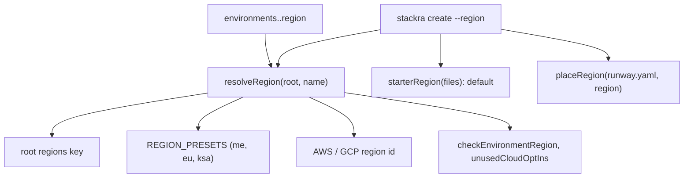

# Implementation Plan: an environment's region is any provider region; me, eu and ksa stay as presets; create asks

**Spec**: `.agents/specs/sta-2896-runway-any-region/spec.md` · **Linear**: STA-2896 · **Date**: 2026-11-27

**Input**: Feature specification from `.agents/specs/sta-2896-runway-any-region/spec.md`

## Summary

`environments.<env>.region` widens from three preset keys to any lower-case region name. A new `resolveRegion` turns a
name into a cloud and location (a `regions` key, then a preset from `REGION_PRESETS`, then an AWS or Google Cloud
region id), and the region checks follow the resolved cloud and location. `stackra create` gains `--region` and a
question, and rewrites the new app's root runway with `placeRegion`.

## Technical Context

- **Language**: TypeScript (ESM), Node 24 (`mise.toml`)
- **Members**: `packages/developer/runway` (lib), `packages/developer/cli` (tool), `tools/schemas`, `apps/docs`
- **Testing**: vitest in `src/**/__tests__/` (ADR 0022); the command test runs `CreateCommand` on the console test harness
- **Storage**: none
- **Runtime target**: the runway `.` entry stays isomorphic; the create path is Node

## Key trade-off and research

- **Trade-off: one free-string field, not a second `regionPreset` field.** A preset is just a name `resolveRegion`
  knows, so every runway that parsed before still parses and reads the same, and there is one place to look. The cost
  is that a typo is caught by `runway validate` (`checkEnvironmentRegion`) rather than by the schema; the schema still
  refuses a malformed name.
- **Trade-off: the cloud is inferred from the id's shape.** AWS ids put a dash before the number (`us-east-1`), Google
  Cloud ids do not (`us-central1`), so the two never collide and no table of regions has to be kept current. A team
  whose id does not fit declares it under `regions` with its cloud.
- **Research**: AWS and Google Cloud region naming; `yaml`'s `Document` API (`setIn`, `deleteIn`, `createPair`,
  `flowCollectionPadding`); ADR 0515's create questions; ADR 0354 decision 4.

## Applicable standards

| Rule                                                   | How it is enforced                                         |
| ------------------------------------------------------ | ---------------------------------------------------------- |
| One declaration per file                               | check: `stackra gen` (`two_declarations_in_file`)          |
| The canonical schema and its copy match the zod        | check: `runwayJsonSchema` test; `pnpm validate` byte check |
| Tests beside their subjects in `__tests__/` (ADR 0022) | check: the repository layout in CI                         |
| Barrel exports exactly its values                      | check: `src/core/__tests__/index.test.ts`                  |
| Changesets for publishable packages                    | check: changeset status in CI                              |

## Constitution Check

| Law                                   | Result | Note                                                             |
| ------------------------------------- | ------ | ---------------------------------------------------------------- |
| Boundaries (tier direction, ADR 0003) | PASS   | `@stackra/cli` (tool) imports `@stackra/runway` (lib), as before |
| Secrets (ADR 0009)                    | PASS   | no secret, account id or project id is read or written           |
| Security                              | PASS   | no auth, network or credential path changes                      |
| HTTP and events                       | N/A    | no route or event                                                |
| Tenancy                               | N/A    | no tenant data                                                   |
| Delegation                            | PASS   | R2 work; independent review before merge                         |
| Not built yet (ADR 0011)              | PASS   | no rejected or deferred technology used                          |
| Test placement (ADR 0022)             | PASS   | every test in `__tests__/` beside its subject                    |
| Versions and catalogs                 | PASS   | no new dependency                                                |
| Deploy modes (ADR 0076)               | PASS   | a file field and a CLI question; same in all three               |
| Licence tier (ADR 0077)               | PASS   | free, MIT                                                        |
| Docs and ADRs                         | PASS   | ADR 0524 amendment (proposed), validate page and README updated  |

## Deploy modes

| Mode       | Behaviour                                                              |
| ---------- | ---------------------------------------------------------------------- |
| SaaS       | an environment names its provider region; Encore Cloud deploys there   |
| On-prem    | `region` is optional outside staging and production of a product; same |
| Air-gapped | same; nothing is contacted to resolve a region                         |

## Correctness properties

- **P-001**: every name the old enum took resolves to the same cloud and location it stood for — Validates: FR-001, FR-002
- **P-002**: an AWS id and a Google Cloud id never resolve to the same cloud by mistake (the dash before the number) — Validates: FR-002
- **P-003**: a placed runway's staging and production resolve to the chosen region and pass the region checks — Validates: FR-005, FR-008
- **P-004**: `--yes` without `--region` writes the starter's runway byte for byte — Validates: FR-009

## Architecture overview



## Components and responsibilities

### C1 Region resolution and checks

**Responsibility**: say what a region name stands for and check a product's placement · **Location**:
`packages/developer/runway/src/core`

```text
packages/developer/runway/
├── src/core/constants/region-presets.constant.ts            (new)
├── src/core/functions/resolve-region.function.ts            (new)
├── src/core/constants/root-environment-schema.constant.ts   (changed: region is a string)
├── src/core/functions/check-environment-region.function.ts  (changed: resolves; neutral messages)
├── src/core/functions/unused-cloud-opt-ins.function.ts      (changed: resolves)
├── src/core/functions/deprecated-fields.function.ts         (changed: message)
├── src/core/enums/region-key.enum.ts                        (docs: the presets)
├── src/core/index.ts                                        (changed: two exports)
├── schema/root.json and tools/schemas/runway-root.schema.json (changed: region string)
└── README.md
```

```ts
export const REGION_PRESETS: Readonly<
  Record<RegionKey, { cloud: RunwayCloud; location: string; jurisdiction: string }>
>;
export function resolveRegion(
  root: Pick<RootRunway, "regions">,
  name: string,
): RunwayRegion | undefined;
```

**Failure modes**: a name that resolves to nothing is a `runway validate` finding, never a throw.

### C2 `stackra create --region`

**Responsibility**: ask where the app runs and place its root runway there · **Location**:
`packages/developer/cli/src/node`

```text
packages/developer/cli/
├── src/node/commands/create.command.ts               (changed: --region, the question)
├── src/node/create/functions/place-region.function.ts  (new)
├── src/node/create/functions/starter-region.function.ts (new)
└── src/node/create/types/starter-region.type.ts         (new)
```

```ts
export function placeRegion(source: string, region: RunwayRegion): string;
export function starterRegion(files: ReadonlyMap<string, Uint8Array>): StarterRegion;
```

**Failure modes**: an unknown `--region` throws before any file is written; a missing `runway.yaml` is left alone.

## Testing strategy

- Unit: `resolve-region.function.test.ts` (precedence, presets, AWS and GCP ids, refusals); `parse-runway-estate.function.test.ts` (schema, every check); `place-region.test.ts` (rewrite, comments, GCP, presets, starterRegion); `create.command.test.ts` (flag, question, `--yes`, refusal).
- Revert check: each behaviour test fails with its source change reverted.

## Rollout

Ships in the next `@stackra/runway` and `@stackra/cli` minor. No migration: every runway that parsed still parses.
