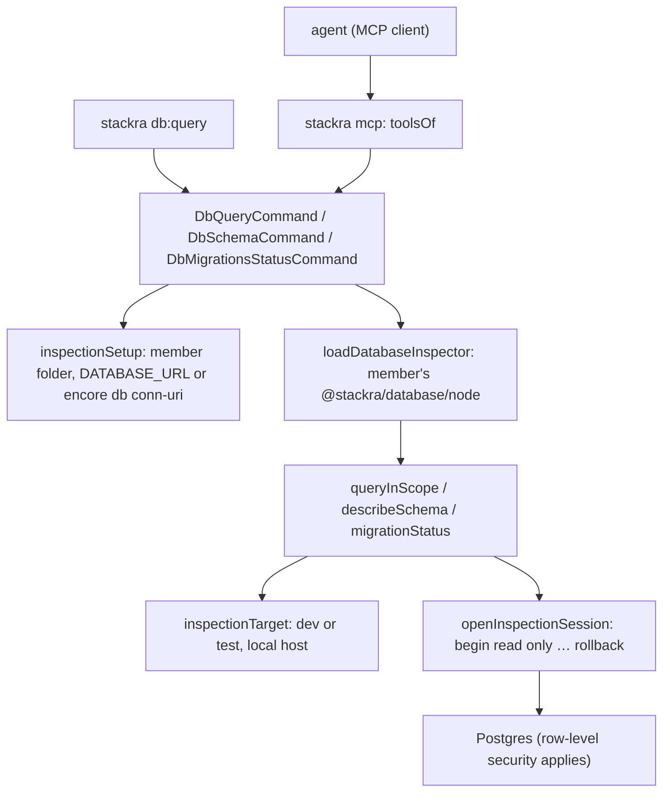
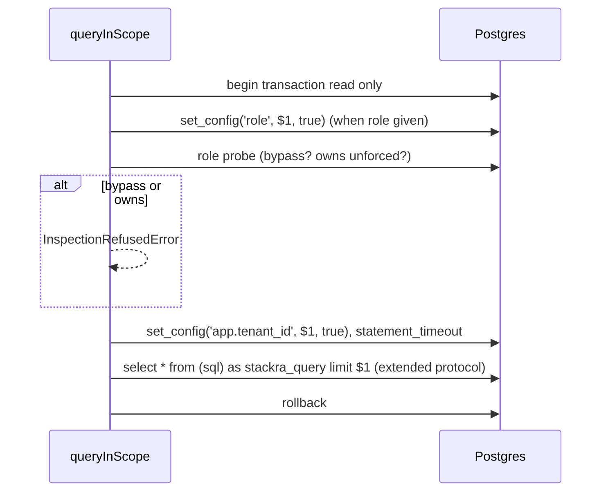

# Implementation Plan: tenant-aware database inspections for the dev MCP, and one Encore path

**Spec**: `.agents/specs/sta-2906-dev-mcp-db-tools/spec.md` · **Linear**: STA-2906 · **Date**: 2026-11-27

**Input**: Feature specification from `.agents/specs/sta-2906-dev-mcp-db-tools/spec.md`

## Summary

`@stackra/database/node` gains three read-only inspections over one connection in a READ ONLY transaction that is
always rolled back: `describeSchema` (catalogue), `queryInScope` (one query as the app role under an explicit tenant)
and `migrationStatus` (compiled files against the recorded version and ledger). The CLI serves them as `db:schema`,
`db:query` and `db:migrations:status`, and `stackra mcp` as `db_*` tools through `toolsOf`. `@stackra/mcp` refuses a
separate local Encore server in `.mcp.yaml`, and the template drops its own.

## Technical Context

- **Language**: TypeScript (ESM), Node 24 (`mise.toml`)
- **Members**: `packages/data/database`, `packages/developer/cli`, `packages/developer/mcp`, `apps/docs` (ADR 0334)
- **Testing**: vitest in `src/**/__tests__/` (ADR 0022); `database-inspection.int.test.ts` on Testcontainers Postgres
- **Storage**: none new; reads only
- **Runtime target**: a developer CLI and its stdio MCP server; local dev and the testbed

## Key trade-off and research

- **Trade-off: explicit tenant, app role, read-only** instead of reusing Encore's `query_database`: the agent must name
  a tenant, and a superuser connection must name the app role, but the answer is the app's, and nothing can turn
  row-level security off or write. Refusing a bypassing role (rather than switching to a guessed one) keeps the tool
  honest on connections whose roles we cannot know.
- **Research**: a probe of a running local Encore app (role `encore-admin`, tables owned by `encore-migrator`, FORCE
  ROW LEVEL SECURITY); pg's simple vs extended protocol (a parameterised statement is parsed as one statement); MikroORM
  7's `execute` inlines parameters and uses the simple protocol, so the caller's text goes through Kysely's
  `executeQuery` with bound parameters instead.

## Applicable standards

| Rule                                                      | How it is enforced                                       |
| --------------------------------------------------------- | -------------------------------------------------------- |
| Tenant set transaction-locally with `set_config(…, true)` | check: `stackra validate --repository`; integration test |
| Raw SQL marked and parameterised (ADR 0160)               | review; every caller value is a bound `$n` parameter     |
| MikroORM only in `@stackra/database` (ADR 0097)           | check: boundaries; the CLI imports the member's module   |
| One declaration per file                                  | check: gen `two_declarations_in_file`                    |
| Tests beside their subjects in `__tests__/` (ADR 0022)    | check: the repository layout in CI                       |
| Barrel exports exactly its values                         | check: `src/node/__tests__/index.test.ts`                |
| Changesets for publishable packages                       | check: changeset status in CI                            |

## Constitution Check

| Law                                   | Result | Note                                                                     |
| ------------------------------------- | ------ | ------------------------------------------------------------------------ |
| Boundaries (tier direction, ADR 0003) | PASS   | the CLI imports the member's `@stackra/database/node` at run time only   |
| Secrets (ADR 0009)                    | PASS   | connection strings by environment name; never printed or returned        |
| Security                              | PASS   | read-only, rolled back, one statement, deployed environments refused     |
| HTTP and events                       | N/A    | no route or event                                                        |
| Tenancy                               | PASS   | explicit tenant, app role, bypassing roles refused; nothing disables RLS |
| Delegation                            | PASS   | R3: not delegated; independent review                                    |
| Not built yet (ADR 0011)              | PASS   | no rejected technology                                                   |
| Test placement (ADR 0022)             | PASS   | every test in `__tests__/`                                               |
| Versions and catalogs                 | PASS   | no new dependency                                                        |
| Deploy modes (ADR 0076)               | PASS   | a developer tool; refuses every deployed environment                     |
| Licence tier (ADR 0077)               | PASS   | free, MIT                                                                |
| Docs and ADRs                         | PASS   | ADR 0334 Enforcement, database README and AGENTS.md, mcp README updated  |

## Deploy modes

| Mode       | Behaviour                                                        |
| ---------- | ---------------------------------------------------------------- |
| SaaS       | not run: `STACKRA_ENVIRONMENT` of a deployed environment refuses |
| On-prem    | same                                                             |
| Air-gapped | same; no outbound call                                           |

## Correctness properties

- **P-001**: a query under tenant T as a role that cannot bypass row-level security answers only rows the policies give T — Validates: FR-004, FR-005
- **P-002**: no inspection leaves a change: every session ends in `rollback`, inside a READ ONLY transaction — Validates: FR-004, FR-006, FR-007
- **P-003**: the caller's text is parsed as one statement, so nothing runs after the transaction ends — Validates: FR-004, NFR-001
- **P-004**: an inspection outside `dev`/`test`, or in `dev` off this machine, never connects — Validates: FR-008
- **P-005**: a `.mcp.yaml` with a local `encore mcp` server never renders — Validates: FR-009

## Architecture overview





## Components and responsibilities

### C1 Inspections in `@stackra/database/node`

**Responsibility**: read a local or testbed database honestly · **Location**: `packages/data/database/src/node/`

```text
packages/data/database/src/node/
├── constants/inspection-limits.constant.ts        (new)
├── errors/inspection-refused.error.ts             (new)
├── functions/inspection-target.function.ts        (new)
├── functions/open-inspection-session.function.ts  (new)
├── functions/scoped-query-input.function.ts       (new)
├── functions/query-in-scope.function.ts          (new)
├── functions/describe-schema.function.ts          (new)
├── functions/migration-status.function.ts         (new)
├── types/inspection-row.type.ts, inspection-session.type.ts, schema-*.type.ts, tenant-query*.type.ts,
│   migration-*-status.type.ts                     (new)
├── index.ts                                       (changed: exports)
└── functions/__tests__/{inspection-target,tenant-query-input}.function.test.ts, database-inspection.int.test.ts (new)
```

```ts
export function describeSchema(options?: {
  schema?: string;
  table?: string;
  env?: Env;
}): Promise<SchemaDescription>;
export function queryInScope(query: ScopedQuery): Promise<ScopedQueryResult>; // query.scope: the tenant's scope id
export function migrationStatus(options: { cwd: string; env?: Env }): Promise<MigrationStatus>;
export class InspectionRefusedError extends UsageError {}
```

**Failure modes**: refused environment, host, role or input → `InspectionRefusedError`; a Postgres error → its message.

### C2 CLI commands and MCP tools

**Responsibility**: the terminal and MCP faces · **Location**: `packages/developer/cli/src/node/`

```text
packages/developer/cli/src/node/
├── commands/db-schema.command.ts, db-query.command.ts, db-migrations-status.command.ts   (new)
├── functions/import-member-database.function.ts      (new; loadDatabaseRunner uses it)
├── functions/load-database-inspector.function.ts      (new)
├── functions/inspection-setup.function.ts             (new)
├── types/database-inspector.type.ts                   (new)
├── constants/commands.constant.ts, mcp-command.constant.ts   (changed)
└── stackra.manifest.json                              (generated)
```

**Behaviour**: resolve the member folder and the environment (a set URL, else `encore db conn-uri <database>` in local
dev), load the member's inspections, run, print a table, return the document.

### C3 One Encore path

**Responsibility**: refuse a separate local Encore server · **Location**: `packages/developer/mcp/src/core/functions/rule-issues.function.ts`; the template's `.mcp.yaml`, `flow.config.json`, `.flow/lock.json`, `docs/template-guide.md`.

## Files and folders

The trees of C1 and C2, plus `packages/developer/mcp` (rule, type doc, tests, README), ADR 0334, the database README
and AGENTS.md, `.changeset/dev-mcp-database-inspections.md`, and this spec.

## Data models and migrations

none

## Contracts

Additive exports of `@stackra/database/node`; three new `stackra` commands and MCP tools; the `.mcp.yaml` code
`separate_encore_server` (breaking for a `.mcp.yaml` that still has a local `encore mcp` server; the changeset says
to remove it). Minor bumps of the fixed `@stackra/*` version.

## Error handling

Refusals are `InspectionRefusedError` (`inspection_refused`, exit 2) or the CLI's usage error with a hint; Postgres
errors pass through with their message; the transaction is rolled back in every case.

## Security and tenancy

Read-only and rolled back; one statement; the tenant is transaction-local; a bypassing role is refused, never used;
`set_config` in a query is refused; deployed environments and off-machine dev hosts are refused before connecting; the
connection string never leaves the environment it travels in.

## Testing strategy

- AC-001 to AC-006: `database-inspection.int.test.ts` (real Postgres), `inspection-target.function.test.ts`,
  `scoped-query-input.function.test.ts`.
- AC-007: `mcp-command.constant.test.ts`, the three command tests, `inspection-setup.function.test.ts`,
  `load-database-inspector.function.test.ts`.
- AC-008: `rule-issues.function.test.ts`, `parse-mcp-config.function.test.ts`; the template diff.
- SC-002: the revert check on box 2 (each guard removed in turn makes its test fail).

## Rollout

Publish with the fixed `@stackra/*` version. A repository whose `.mcp.yaml` runs `encore mcp` removes that entry
before upgrading the CLI (the template does so in the same batch).

## Partial-failure ordering

The CLI loads the member's `@stackra/database/node`; an older member version is told to update. The template change
can land before or after the core release (the old CLI accepts a `.mcp.yaml` without the entry).

## Delegation and risk plan

R3: Claude only, one wave, independent security review before merge.

## ADRs

ADR 0282 (decision 5), ADR 0334 (rule 8; Enforcement updated), ADR 0495, ADR 0473 (decision 3), ADR 0097, ADR 0159.

## Docs

ADR 0334; `packages/data/database/README.md` and `AGENTS.md`; `packages/developer/mcp/README.md`.

## Complexity tracking

none

## Open questions

None.
