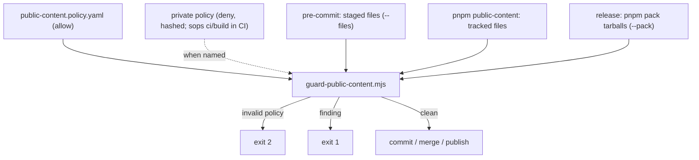

# Implementation Plan: a public-content guard driven by a policy file

**Spec**: `.agents/specs/sta-2911-public-content-policy/spec.md` · **Linear**: STA-2911 · **Date**: 2026-11-27

**Input**: Feature specification from `.agents/specs/sta-2911-public-content-policy/spec.md`

## Summary

The STA-2876 guard's allow list becomes the public policy file `tools/scripts/public-content.policy.yaml` (`allow`
only), and the denied terms (hashed `deny` entries) become a private policy outside the repository, read from
`--private-policy <file>` or `PUBLIC_CONTENT_PRIVATE_POLICY_FILE`. The guard validates both and refuses to scan with an
invalid one. It runs as `pnpm public-content` in `pnpm validate`
(so in `pnpm verify` and the Quality Gate), on staged files in the pre-commit hook (`--files`), and in both release pack
steps (`--pack`, unchanged). The Quality Gate decrypts the private policy from sops once the owner turns it on.

## Technical Context

- **Language**: Node scripts (`.mjs`), Node 24 (`mise.toml`); YAML (lefthook, the policy)
- **Members**: tools/scripts; the root `package.json`; `.flow/overrides/hooks` and `lefthook.yml`; apps/docs (prose)
- **Testing**: `node --test tools/scripts/__tests__/*.test.mjs` (in `pnpm validate`)
- **Storage**: none
- **Runtime target**: repository tooling and git hooks

## Key trade-off and research

- **Trade-off: a private deny list, not hashes in public.** A SHA-256 of a short name is recovered by hashing a short
  list of guesses, so a hashed name in a public file publishes the name (CTO ruling, 27 Nov). The denied terms live in
  a private policy; without it the guard checks home folders and says the names were not checked, and a named private
  policy that cannot be read fails closed. A keyed HMAC was the other option; it would still need a private key and
  someone who knows the terms to recompute the entries, while the private policy moves the existing entries as they are.
- **Trade-off: an invalid policy fails closed.** A typo in an entry exits 2 and checks nothing, so it fails the hook,
  validate and the release instead of quietly checking less.
- **Trade-off: no wording exemption for approval lines.** The item asked to exempt the approval-line format; the
  STA-2876 review removed a wording exemption because it let person names through. The role-only format
  (`Approved by CTO <date>`, STA-2905) carries no denied term and passes on its own, which the tests hold.
- **Research**: lefthook `{staged_files}` (added, copied, modified, renamed paths, relative to the root).

## Applicable standards

| Rule                                                   | How it is enforced                                               |
| ------------------------------------------------------ | ---------------------------------------------------------------- |
| No internal content in tracked files                   | check: `pnpm public-content` in `pnpm validate`; pre-commit hook |
| No internal content in tarballs                        | check: the tarball steps in `runway-npm.yml` and `release.yml`   |
| No secret-shaped strings                               | check: gitleaks (lefthook, `pnpm secrets:scan`), unchanged       |
| Tests beside their subjects in `__tests__/` (ADR 0022) | check: the repository layout in CI                               |
| Hooks rendered from the preset overrides               | check: `fflow sync` (the lock file)                              |

## Constitution Check

| Law                                   | Result | Note                                      |
| ------------------------------------- | ------ | ----------------------------------------- |
| Boundaries (tier direction, ADR 0003) | PASS   | no new import                             |
| Secrets (ADR 0009)                    | PASS   | no secret read or named                   |
| Security                              | PASS   | personal and infrastructure data kept out |
| HTTP and events                       | N/A    | no route or event                         |
| Tenancy                               | N/A    | no tenant data                            |
| Delegation                            | PASS   | not delegated                             |
| Not built yet (ADR 0011)              | PASS   | no rejected or deferred technology used   |
| Test placement (ADR 0022)             | PASS   | the test is in `__tests__/`               |
| Versions and catalogs                 | PASS   | no dependency added                       |
| Deploy modes (ADR 0076)               | PASS   | same in all three                         |
| Licence tier (ADR 0077)               | PASS   | free, MIT                                 |
| Docs and ADRs                         | PASS   | scripts README and release runbook        |

## Deploy modes

| Mode       | Behaviour                              |
| ---------- | -------------------------------------- |
| SaaS       | none: repository tooling               |
| On-prem    | same                                   |
| Air-gapped | same; the guard reads local files only |

## Correctness properties

- **P-001**: the effective deny list is exactly the private policy's `deny` entries, and empty without one — Validates: FR-001
- **P-002**: every policy that breaks FR-002 yields at least one problem, and any problem stops every scan with exit 2 — Validates: FR-002, FR-003
- **P-003**: `--files` reports exactly what a whole-repository scan reports for those files — Validates: FR-005
- **P-004**: no output of `--hash`, and no line of the guard or the public policy, holds a denied term or its hash — Validates: FR-006, NFR-001
- **P-005**: in every scanning mode (tracked files, `--files`, `--pack`) the allow list comes from the `--policy` file or `tools/scripts/public-content.policy.yaml`, and the deny list from `--private-policy` or `PUBLIC_CONTENT_PRIVATE_POLICY_FILE` — Validates: FR-004
- **P-006**: `pnpm validate`, which `pnpm verify` and the Quality Gate run, includes `pnpm public-content`, and that script runs the guard over the tracked files — Validates: FR-007
- **P-007**: every pre-commit hook source (`lefthook.yml` and its override) runs `--files {staged_files}`, and every release pack step runs `--pack` — Validates: FR-008
- **P-009**: the Quality Gate's private-policy steps run only when the repository variable is `sops`, before `pnpm validate`, and set `PUBLIC_CONTENT_PRIVATE_POLICY_FILE` — Validates: FR-010
- **P-008**: for every line the result depends only on the denied terms it holds and the policy's line entries, never on its wording; a line in the role-only approval format holds no denied term and yields no finding — Validates: FR-009

## Architecture overview



## Components and responsibilities

Two components: C1 reads and checks the policy and scans files and tarballs; C2 wires the guard into validate,
the pre-commit hook and the release pack steps.

### C1 The policy and the guard

**Responsibility**: read and check the policy; find denied terms and home folders · **Location**: `tools/scripts`

```text
tools/scripts/
├── guard-public-content.mjs                    (changed)
├── public-content.policy.yaml                  (renamed from public-content.allow.yaml; allow only)
├── README.md                                   (changed)
└── __tests__/guard-public-content.test.mjs     (changed)
```

```ts
export const POLICY_FILE: string; // the public policy
export const PRIVATE_POLICY_ENV: "PUBLIC_CONTENT_PRIVATE_POLICY_FILE";
export const EMPTY_POLICY: Policy; // nothing denied, nothing allowed
type Policy = { deny: Map<string, { length: number; reason: string }>; allow: AllowEntry[] };
export function parsePolicy(document: unknown): { policy: Policy; errors: string[] };
export function parsePrivatePolicy(document: unknown): { deny: Policy["deny"]; errors: string[] };
export function readPolicy(
  file?: string,
  privateFile?: string,
): { policy: Policy; errors: { file: string; problem: string }[]; hasPrivate: boolean };
export function lineFindings(line: string, deny?: Policy["deny"]): string[];
export function scanText(path: string, text: string, policy?: Policy): Finding[];
export function scanTarball(label: string, bytes: Buffer, policy?: Policy): Finding[];
```

**Behaviour**: as STA-2876, against the private policy's deny list (none without one, said on stderr). **Failure modes**: an invalid policy exits 2; a
finding exits 1.

### C2 Wiring

**Responsibility**: run the guard in validate and before each commit · **Location**: the repository root

```text
package.json                                 (changed: script public-content, in validate)
.flow/overrides/hooks/lefthook.yml.txt       (changed: pre-commit job public-content)
.flow/overrides/hooks/lefthook.yml           (changed: the override's reason)
lefthook.yml                                 (rendered by fflow sync)
.github/workflows/ci.yml                     (changed: the Quality Gate's private-policy steps)
runway.yaml                                  (changed: the secret name PUBLIC_CONTENT_PRIVATE_POLICY)
.flow/lock.json                              (rendered by fflow sync)
apps/docs/src/docs/runbooks/release.mdx      (changed)
```

```ts
// package.json scripts (JSON shown as its TypeScript shape)
type Scripts = { "public-content": "node tools/scripts/guard-public-content.mjs" };
```

**Behaviour**: the hook skips with a message without node or the install. **Failure modes**: a finding fails the
commit, validate or the release.

## Files and folders

The trees of C1 and C2.

## Data models and migrations

none

## Contracts

- `tools/scripts/public-content.policy.yaml` replaces `public-content.allow.yaml` (its `allow` list unchanged; a `deny`
  key is refused).
- The private policy: `deny: [{ sha256, length, reason }]`, read from `--private-policy <file>` or
  `PUBLIC_CONTENT_PRIVATE_POLICY_FILE`; in CI the sops name `PUBLIC_CONTENT_PRIVATE_POLICY` (ci/build).
- `guard-public-content.mjs`: `--policy`, `--private-policy`, `--files` added; `--hash` prints `{ sha256, length, reason }`.
- Root script `pnpm public-content`.

## Error handling

Each policy problem prints as `<policy>: <problem>`, then exit 2; each finding as `path:line: reason`, then exit 1.

## Security and tenancy

No public file holds a denied term or its hash; the private policy holds the hashes and lives outside the repository
(in CI, the sops scope ci/build, decrypted by the job's own identity and masked). No tenant data.

## Testing strategy

- AC-001 to AC-003, AC-006: `guard-public-content.test.mjs`.
- AC-004: a staged file under lefthook on a clean checkout. AC-005: `pnpm public-content` on this branch.
- AC-007: review of `tools/scripts/README.md` and the release runbook against the policy file and the wiring.
- P-001 to P-004: the policy, private-policy, invalid-policy and `--hash` cases of the same test file.
- P-005: the cases "the private policy denies its terms, by flag or by environment" and "an invalid policy stops every scan".
- P-009: the case "the guard runs in validate, before each commit and in both release pack steps" (the ci.yml checks).
- P-006, P-007: the case "the guard runs in validate, before each commit and in both release pack steps".
- P-008: the cases "an approval line that names a person is a finding" and "the role-only approval format passes".

## Rollout

Merge after PR #1197; the hook is installed by `pnpm install` (lefthook) for every contributor. Owner steps: add
`PUBLIC_CONTENT_PRIVATE_POLICY` to the sops scope ci/build with the hashed `deny` entries, then set the repository
variable `PUBLIC_CONTENT_PRIVATE_POLICY` to `sops`; until then the Quality Gate checks home folders only and says so.
