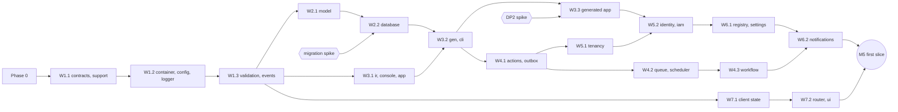

This plan turns the owner's decisions (ADRs [0075](/adr/0075-stackra-ships-packages-figentra-os-ships-services) to [0122](/adr/0122-workflow-studio-three-layers), the [package port plan](/adr/0084-figentra-os-package-port-plan) and the 2026-10-19 questionnaire rounds) into an ordered, executable sequence. Its ordering rules are [ADR 0123](/adr/0123-delivery-order-follows-the-dependency-graph), which is Proposed.

<Warning>
  This is a plan, not a commitment. Where it depends on a question the owner has not answered yet,
  it says **assumed: &lt;recommended default&gt;, pending owner**, and keys the question to the gap
  questionnaire (OR1, FO4, FW1 and so on). A changed answer re-orders only the waves that depend on
  it.
</Warning>

Stackra ships packages, and nothing deployable ([0075](/adr/0075-stackra-ships-packages-figentra-os-ships-services)). "Delivered" here means the package is merged, green, documented and publishable to npmjs with provenance. The reference services under `services/` are test beds that prove the packages end to end.

## How to read this page

- **Phases** run in dependency order. **Waves** inside a phase are package-disjoint, so each wave can be split across agents with no shared files.
- **Source:** _Figentra OS, as-is_ or _port + adapt_ or _redesign_ ports from `/Users/akouta/Projects/figentra/packages/os/<category>/<name>` and is relicensed to MIT on port ([0084](/adr/0084-figentra-os-package-port-plan)). _Medusa (MIT parts)_ ports only Medusa's MIT paths, never its Enterprise paths. _Fresh_ is written new.
- **Tier:** every package in this table is free (`@stackra/*`, MIT). Pro work (`@stackra-pro/*`) lives in the private `figentra/stackra-pro` repository and is tracked as one track ([0077](/adr/0077-open-core-free-and-pro-lists)).
- **Lane** follows [0120](/adr/0120-sdlc-spec-location-lanes-and-change-risk): a new package is change risk R2 or higher, so it takes the **full** lane. A mechanical _as-is_ port takes the **lite** lane (assumed: 0084 says only adapt, redesign and fresh rows need a spec; pending owner). Packages under `packages/security/**`, and the outbox and database packages, are R3: blocking security review and owner approval before merge.
- **Issue** is the package's Linear issue in team STA. Each package issue is a child of its wave issue, and its blocked-by relations mirror the "Depends on" column. Specs create the task issues later; this plan creates none.

## Common definition of done

Every package row adds its own "Done when" line to this list.

<Steps>
  <Step title="The gate is green">
    `pnpm verify` passes on the merge commit: format, lint, typecheck, test, build, validate,
    boundaries and knip.
  </Step>
  <Step title="Tests prove it at the agreed floor">
    Tests sit in `__tests__/` ([0022](/adr/0022-tests-live-in-tests-folders)). Coverage is 80% lines
    and functions and 70% branches; security, tenancy, iam, actions, outbox, workflow, versioning
    and validation reach 90/80 (assumed: TS3 a, pending owner). Integration tests use Testcontainers
    with Postgres, pgvector and ltree (assumed: TS4 a, pending owner).
  </Step>
  <Step title="It meets the port conventions">
    File-contract docblocks, one export per file, `#` subpath imports, no `any`, non-null assertions
    or enums, no `Reflect` metadata, and diagnostics coded `STK`
    ([0084](/adr/0084-figentra-os-package-port-plan) decision 1). Entries follow the package layout
    (assumed: FW1 a, pending owner).
  </Step>
  <Step title="Drivers prove every deploy mode">
    A driver package ships a conformance suite. The suite runs in the air-gapped CI job once that
    job exists (spike STA-141), and the spec's Impact section answers SaaS, on-prem and air-gapped
    ([0076](/adr/0076-every-package-runs-saas-on-prem-and-air-gapped)).
  </Step>
  <Step title="It is documented and releasable">
    A docs page, a changeset, and, for adapt, redesign and fresh rows, the package design ADR
    ([0018](/adr/0018-framework-design-record)). The Linear issue is Done with the PR attached.
  </Step>
</Steps>

## Build order and delivery scope

The build order is the Figentra OS order from [0205](/adr/0205-the-figentra-os-build-order-and-the-first-slice): foundation first; then identity, tenancy and access; then audit, settings and entitlements; then notifications and files; then search, registry, experience and content; then webhooks, integrations and the developer platform; then workflow and AI; then billing, usage and payments; then the rest.

Delivery is SaaS first ([0248](/adr/0248-delivery-scope-saas-first-on-prem-kept-green)). Everything in the register is built. The SaaS path is finished and sold first. On-prem and air-gapped builds stay green in CI, but are not sold or described as finished until they are solid.

## Phases at a glance

| Phase | Name                                | Waves            | Linear project                         | Starts after       | Exit milestone |
| ----- | ----------------------------------- | ---------------- | -------------------------------------- | ------------------ | -------------- |
| 0     | SDLC and repo hygiene (in progress) | Phase 0 items    | Spec-kit SDLC, Foundation ADRs, Runway | now                | M0             |
| 1     | Foundation kernel                   | W1.1, W1.2, W1.3 | Foundation kernel                      | Phase 0            | M1             |
| 2     | Data layer                          | W2.1, W2.2       | Data layer                             | W1.3               | (part of M2)   |
| 3     | Codegen and the generated app       | W3.1, W3.2, W3.3 | Codegen                                | W1.3; W3.2 on W2.2 | M2             |
| 4     | Actions and messaging               | W4.1, W4.2, W4.3 | Actions and messaging                  | W3.2               | M3             |
| 5     | Security and tenancy                | W5.1, W5.2, W5.3 | Security and tenancy                   | W4.1; W5.2 on W3.3 | M4             |
| 6     | Platform capabilities and AI        | W6.1, W6.2, W6.3 | Platform capabilities, AI runtime      | W5.2               | M5 (with 7)    |
| 7     | Client and experience               | W7.1, W7.2, W7.3 | Client and experience                  | W1.3               | M6             |
| R     | Runway and distribution (track)     | R                | Runway CI/CD, Product starter          | now                | feeds M1, M2   |
| Pro   | Stackra Pro (track)                 | PRO              | Stackra Pro (open-core)                | W5.2 and W7.3      | M7             |

## Phase 0: SDLC and repo hygiene

Other agents own this phase right now; this plan only lists it so Phase 1 can wait for it. Nothing in Phase 1 starts until these land.

| Item                                                                    | Issue                                  | Why Phase 1 waits                                             |
| ----------------------------------------------------------------------- | -------------------------------------- | ------------------------------------------------------------- |
| SDLC Phase 0: stage-aware spec gate, `.agents/specs` wrap, retire sdlc  | STA-39                                 | Every package spec runs through the gate                      |
| MIT `LICENSE`, validator licence and exports rules (0024, 0025)         | STA-46                                 | The first package must validate as MIT with compiled exports  |
| Catalog hygiene: exact pins, drop expo-router, forbidden list           | STA-47                                 | New packages add catalog entries                              |
| CI hardening: SHA pins, permissions, mise                               | STA-48                                 | Runway builds on the hardened workflow                        |
| Encore as the generated runtime target (amend 0010, supersede 0011 row) | STA-49                                 | Phase 3 emits an Encore app                                   |
| Constitution amendments to match Accepted ADRs                          | STA-50                                 | `/speckit.analyze` treats a constitution conflict as critical |
| Stale docs, rules and code sweep                                        | STA-51                                 | Agents read the rules                                         |
| Settle the remaining Proposed ADRs (OR1)                                | STA-134                                | Phase 1 relies on 0044, 0076, 0077, 0079–0089                 |
| Package entries layout and scaffold templates (FW1, FW2)                | STA-135                                | The scaffold must match before the first port                 |
| Apps and services move to `@figentra/*` (0083)                          | in flight (`chore/figentra-app-scope`) | Frees the `@stackra/console` name for W3.1                    |

## Phase 1: Foundation kernel

The kernel every other package imports. W1.1 has no workspace dependencies, so it can start the moment Phase 0 lands.

#### W1.1 · Kernel primitives (STA-52)

| Package                | Source                    | ADRs                   | Depends on | Tier | Lane | Issue  | Done when                                                                                                                                    |
| ---------------------- | ------------------------- | ---------------------- | ---------- | ---- | ---- | ------ | -------------------------------------------------------------------------------------------------------------------------------------------- |
| `foundation/contracts` | Figentra OS, port + adapt | 0117, 0082, 0006, 0007 | none       | free | full | STA-74 | PublicId, Actor (AI3b), EventEnvelope, Page, the nine error kinds with STK codes (FW7) and the diagnostics catalogue ship; zero runtime deps |
| `foundation/support`   | Figentra OS, port + adapt | 0084                   | none       | free | full | STA-75 | Laravel-style helpers added, still dependency-free, every export docblocked                                                                  |

#### W1.2 · Container, config and logger (STA-53)

| Package                | Source                    | ADRs                   | Depends on         | Tier | Lane | Issue  | Done when                                                                                                                         |
| ---------------------- | ------------------------- | ---------------------- | ------------------ | ---- | ---- | ------ | --------------------------------------------------------------------------------------------------------------------------------- |
| `foundation/container` | Figentra OS, as-is        | 0005, 0042, 0117, 0090 | contracts, support | free | lite | STA-76 | WeakMap metadata, @Injectable/@Inject/@Module, createDecorator/createParamDecorator, and scan + plan without instantiating (0090) |
| `foundation/config`    | Figentra OS, port + adapt | 0044, 0107, 0009       | container          | free | full | STA-77 | package defaults in `config/<pkg>.config.ts`, publish and override per host, secret references only (FW3)                         |
| `foundation/logger`    | Figentra OS, port + adapt | 0085, 0073             | container, config  | free | full | STA-78 | console, CloudWatch, Encore log, Sentry and Better Stack reporters behind one driver contract with a conformance suite            |

#### W1.3 · Validation, events core, storage, filesystem, i18n, devtools-kit (STA-54)

| Package                  | Source                    | ADRs       | Depends on           | Tier | Lane | Issue  | Done when                                                                                                                                                |
| ------------------------ | ------------------------- | ---------- | -------------------- | ---- | ---- | ------ | -------------------------------------------------------------------------------------------------------------------------------------------------------- |
| `foundation/validation`  | Fresh                     | 0095       | contracts, support   | free | full | STA-79 | decorators compile once per class to a cached z.object; X.parse() returns an instance or an STK ValidationError; @Hidden/@Visible serializer by audience |
| `foundation/events`      | Figentra OS, port + adapt | 0078       | container, contracts | free | full | STA-80 | in-process bus, @OnEvent, source/sink contracts and the BroadcastChannel sink; outbox wiring lands in W4.1                                               |
| `foundation/storage`     | Figentra OS, as-is        | 0084       | container            | free | lite | STA-81 | ported with docblocks and STK diagnostics, tests green                                                                                                   |
| `foundation/filesystem`  | Figentra OS, as-is        | 0084, 0034 | container, config    | free | lite | STA-82 | local and S3-compatible drivers pass one conformance suite, including the air-gapped job                                                                 |
| `foundation/i18n`        | Figentra OS, as-is        | 0080       | container            | free | lite | STA-83 | ported without i18next; ICU plurals and typed keys confirmed or added (PP10)                                                                             |
| `developer/devtools-kit` | Figentra OS, as-is        | 0084       | container            | free | lite | STA-84 | tab contract ported; no package registers a tab it does not need                                                                                         |

## Phase 2: Data layer

`@stackra/model` stays client-safe; `@stackra/database` is the only package that imports MikroORM ([0097](/adr/0097-model-and-database-packages)). The migration spike (STA-137) must pass before database's plan.

#### W2.1 · Model and traits (STA-55)

| Package      | Source | ADRs                   | Depends on            | Tier | Lane | Issue  | Done when                                                                                                        |
| ------------ | ------ | ---------------------- | --------------------- | ---- | ---- | ------ | ---------------------------------------------------------------------------------------------------------------- |
| `data/model` | Fresh  | 0097, 0096, 0046, 0082 | validation, container | free | full | STA-85 | @Model, fields, relations as metadata, scopes, state machine, createTrait and the trait registry; imports no ORM |

#### W2.2 · Database, locking and cache (STA-56)

| Package           | Source                    | ADRs                   | Depends on                       | Tier | Lane | Issue  | Done when                                                                                                                                                        |
| ----------------- | ------------------------- | ---------------------- | -------------------------------- | ---- | ---- | ------ | ---------------------------------------------------------------------------------------------------------------------------------------------------------------- |
| `data/database`   | Fresh                     | 0097, 0014, 0104, 0105 | model, config, container, logger | free | full | STA-86 | the only @mikro-orm/\* importer: EntitySchema from gen, cursor paginator, @Crud methods, @Link + query.graph, factories, seeders, migrations as SQL files (DP12) |
| `runtime/locking` | Medusa (MIT parts)        | 0103                   | database, container              | free | full | STA-87 | named locks behind a driver (Postgres advisory, memory) with a conformance suite                                                                                 |
| `runtime/cache`   | Figentra OS, port + adapt | 0084, 0036             | container, config                | free | full | STA-88 | memory, Encore cache and Redis/Valkey drivers pass one conformance suite                                                                                         |

## Phase 3: Codegen and the generated app

Plain-TS services with no `encore.*` files; `stackra gen` emits the Encore app into the gitignored `.stackra/encore` ([0090](/adr/0090-codegen-discovery-by-root-module), [0091](/adr/0091-generated-encore-app-in-stackra-folder)). The G3 spike passed 6/6 and the hot-reload spike measured about 0.6 s per edit; their constraints become requirements (export identity matching, explicit handler types, typed error mapping, build order, no `encore build docker` inside worktrees).

#### W3.1 · IR, console framework and app runtime (STA-57)

| Package              | Source                    | ADRs       | Depends on                | Tier | Lane | Issue  | Done when                                                                                                                                                     |
| -------------------- | ------------------------- | ---------- | ------------------------- | ---- | ---- | ------ | ------------------------------------------------------------------------------------------------------------------------------------------------------------- |
| `application/ir`     | Figentra OS, port + adapt | 0092       | contracts, validation     | free | full | STA-89 | v:1 envelope, deterministic serialise and parse, cycle detection, compat rule, SchemaIR to Zod; kinds model, endpoint, event, job, cron, resource, permission |
| `experience/console` | Figentra OS, port + adapt | 0083       | container, config         | free | full | STA-90 | command kernel, terminal and prompter ports; needs the apps renamed to @figentra/\* first                                                                     |
| `runtime/app`        | Figentra OS, port + adapt | 0084, 0042 | container, config, logger | free | full | STA-91 | boot on @stackra/container; the node entry imports no React                                                                                                   |

#### W3.2 · stackra gen and the stackra binary (STA-58)

| Package         | Source                    | ADRs                   | Depends on                              | Tier | Lane | Issue  | Done when                                                                                                                                                                                                                                 |
| --------------- | ------------------------- | ---------------------- | --------------------------------------- | ---- | ---- | ------ | ----------------------------------------------------------------------------------------------------------------------------------------------------------------------------------------------------------------------------------------- |
| `developer/gen` | Fresh                     | 0090, 0091, 0092, 0097 | ir, container, model, database, console | free | full | STA-92 | reads root modules from package.json, emits .stackra/encore, EntitySchema files, app-manifest.json and openapi.json; gen --check fails CI when stale; validation pass for duplicate paths, missing perms, unversioned events, exposed PII |
| `developer/cli` | Figentra OS, port + adapt | 0083, 0091             | console, gen                            | free | full | STA-93 | the stackra binary: gen, dev (gen --watch + encore run), build (gen + encore build docker), make, migrate, seed                                                                                                                           |

#### W3.3 · Generated Encore app and reference services (STA-59)

| Deliverable          | Source | ADRs             | Depends on                           | Lane | Done when                                                                                                                                                                                                                |
| -------------------- | ------ | ---------------- | ------------------------------------ | ---- | ------------------------------------------------------------------------------------------------------------------------------------------------------------------------------------------------------------------------ |
| Generated Encore app | Fresh  | 0091, 0090       | gen, cli, spikes STA-136 and STA-138 | full | `stackra dev` runs; `encore test` checks the generated wiring only (routes, auth handler, topics, crons) while business logic is tested on the plain-TS packages (assumed: TS5 a, pending owner); `gen --check` gates CI |
| Reference services   | Fresh  | 0075, 0090, 0091 | the generated app                    | full | One reference Encore app with identity, notes and registry replaces `services/example` and `services/health` (assumed: FW10 a, pending owner); identity and registry gain behaviour in Phases 5 and 6                    |

## Phase 4: Actions and messaging

Every operation is an action; a workflow sits behind it only when the criteria hit ([0098](/adr/0098-actions-are-the-unit), [0101](/adr/0101-action-first-workflow-behind-when-needed)). The eight messaging packages are fixed by [0078](/adr/0078-messaging-layer-eight-packages); events landed in W1.3 and the notifications service (no package, [0270](/adr/0270-builder-architecture-one-editor-kernel-document-kinds-and-collaboration-levels)) lands in `figentra/figentra-os` alongside W6.2.

#### W4.1 · Actions and outbox (STA-60)

| Package               | Source | ADRs                         | Depends on                               | Tier | Lane | Issue  | Done when                                                                                                                                   |
| --------------------- | ------ | ---------------------------- | ---------------------------------------- | ---- | ---- | ------ | ------------------------------------------------------------------------------------------------------------------------------------------- |
| `application/actions` | Fresh  | 0098, 0099, 0101, 0081, 0082 | container, validation, contracts, events | free | full | STA-94 | key@version actions, the fixed pipeline with gate slots (FW5), actor chain, L0-L4 risk, idempotency; adapters for HTTP, MCP, queue and cron |
| `runtime/outbox`      | Fresh  | 0078                         | database, events                         | free | full | STA-95 | outbox table, relay, inbox dedup; staged rows promoted to ready on success; heartbeat metric (OB10)                                         |

#### W4.2 · Queue and scheduler (STA-61)

| Package             | Source                    | ADRs | Depends on                  | Tier | Lane | Issue  | Done when                                                                                                                             |
| ------------------- | ------------------------- | ---- | --------------------------- | ---- | ---- | ------ | ------------------------------------------------------------------------------------------------------------------------------------- |
| `runtime/queue`     | Figentra OS, port + adapt | 0078 | outbox, database, container | free | full | STA-96 | delayed and run-at jobs, retries, dead-letter queue; Encore topic, Postgres SKIP LOCKED and memory drivers pass one conformance suite |
| `runtime/scheduler` | Figentra OS, port + adapt | 0078 | queue, locking              | free | full | STA-97 | recurring cron only: Encore CronJob in SaaS, croner + advisory lock on-prem; handlers only dispatch                                   |

#### W4.3 · Workflow, webhooks, realtime and versioning (STA-62)

| Package                    | Source                    | ADRs                   | Depends on                                | Tier | Lane | Issue   | Done when                                                                                                       |
| -------------------------- | ------------------------- | ---------------------- | ----------------------------------------- | ---- | ---- | ------- | --------------------------------------------------------------------------------------------------------------- |
| `runtime/workflow`         | Medusa (MIT parts)        | 0102, 0094, 0101, 0122 | actions, queue, outbox, locking, database | free | full | STA-98  | declarative @Step graph, compensation, retries, Postgres journal, outbox staging, hooks, versioned runs (FW9)   |
| `communication/webhooks`   | Fresh                     | 0078, 0118             | outbox, queue, events                     | free | full | STA-99  | Standard Webhooks signing and verification, inbound as an event source, outbound delivery with retries          |
| `runtime/realtime`         | Figentra OS, port + adapt | 0078, 0084             | events                                    | free | full | STA-100 | trimmed to channels and fan-out; self-hosted driver added; presence and co-editing moved to Pro                 |
| `communication/versioning` | Fresh                     | 0118                   | actions, contracts                        | free | full | STA-101 | dormant response-only transform chain, Stackra-Version pin per key or OAuth app, Deprecation and Sunset headers |

## Phase 5: Security and tenancy

All R3. Claude runs these specs; nothing here is delegated ([0066](/adr/0066-delegation-to-opencode-by-routing-matrix)). The free tier is pool tenancy with RLS, RBAC behind `check()` and Better Auth core; the scope tree, DB-per-tenant and the Zanzibar engine are Pro drivers behind the same contracts ([0088](/adr/0088-tenancy-free-pool-pro-silo-and-scope)).

#### W5.1 · Tenancy, entitlements gate, consent and CSP (STA-63)

| Package                 | Source                    | ADRs       | Depends on                     | Tier | Lane | Issue   | Done when                                                                                                        |
| ----------------------- | ------------------------- | ---------- | ------------------------------ | ---- | ---- | ------- | ---------------------------------------------------------------------------------------------------------------- |
| `security/tenancy`      | Figentra OS, port + adapt | 0088, 0046 | database, contracts, container | free | full | STA-102 | pool + RLS, withTenant, connection-resolver contract, the isolation test kit gen emits per HasTenant model (TS6) |
| `security/entitlements` | Fresh                     | 0077, 0081 | contracts, actions             | free | full | STA-103 | gate interface plus plan and limit contracts in the entitlement slot; engine is Pro                              |
| `security/consent`      | Figentra OS, as-is        | 0084, 0298 | container                      | free | lite | STA-104 | ported; the unused @heroui/react peer dropped                                                                    |
| `security/csp`          | Figentra OS, as-is        | 0084       | container                      | free | lite | STA-105 | ported, tests green                                                                                              |

#### W5.2 · Identity and IAM (STA-64)

| Package             | Source                    | ADRs       | Depends on                      | Tier | Lane | Issue   | Done when                                                                                                                                                         |
| ------------------- | ------------------------- | ---------- | ------------------------------- | ---- | ---- | ------- | ----------------------------------------------------------------------------------------------------------------------------------------------------------------- |
| `security/identity` | Figentra OS, port + adapt | 0087, 0093 | database, model, gen, container | free | full | STA-106 | Better Auth local driver, own MikroORM adapter passing @better-auth/test-utils, @AuthHooks, raw /api/auth/\* and authHandler through gen, Expo SecureStore client |
| `security/iam`      | Figentra OS, port + adapt | 0087, 0099 | tenancy, actions                | free | full | STA-107 | RBAC behind check(subject, relation, object) in the iam slot; agents as principals with user ∩ agent access; PATs                                                 |

#### W5.3 · Connections store (STA-65)

| Package                | Source | ADRs       | Depends on                | Tier | Lane | Issue   | Done when                                                                                                             |
| ---------------------- | ------ | ---------- | ------------------------- | ---- | ---- | ------- | --------------------------------------------------------------------------------------------------------------------- |
| `security/connections` | Fresh  | 0107, 0009 | database, tenancy, config | free | full | STA-108 | envelope-encrypted tenant credentials, @ConnectionRef in settings, KMS and local-key drivers, OAuth token refresh job |

## Phase 6: Platform capabilities and AI

#### W6.1 · Registry, settings and feature flags (STA-66)

| Package                | Source                    | ADRs       | Depends on                       | Tier | Lane | Issue   | Done when                                                                                                               |
| ---------------------- | ------------------------- | ---------- | -------------------------------- | ---- | ---- | ------- | ----------------------------------------------------------------------------------------------------------------------- |
| `application/registry` | Fresh                     | 0109, 0111 | ir, contracts                    | free | full | STA-109 | manifest contracts and client; the reference registry service accepts CI-published manifests                            |
| `state/settings`       | Figentra OS, port + adapt | 0108       | database, tenancy, iam, registry | free | full | STA-110 | settings_values table per service, @Settings/@Setting in the manifest, default→platform→tenant→user resolver with locks |
| `state/feature-flags`  | Figentra OS, port + adapt | 0081, 0084 | config, actions                  | free | full | STA-111 | config, service and PostHog providers; a gate in the chain                                                              |

#### W6.2 · Notifications, search, media and analytics (STA-67)

| Package                                                     | Source                    | ADRs       | Depends on                                                   | Tier | Lane | Issue   | Done when                                                                                                                                                                                                                                                                                                                                                                                 |
| ----------------------------------------------------------- | ------------------------- | ---------- | ------------------------------------------------------------ | ---- | ---- | ------- | ----------------------------------------------------------------------------------------------------------------------------------------------------------------------------------------------------------------------------------------------------------------------------------------------------------------------------------------------------------------------------------------- |
| `@figentra/service-notifications` in `figentra/figentra-os` | Fresh                     | 0086, 0270 | outbox, queue, scheduler, tenancy, iam, settings, i18n, mail | free | full | STA-112 | built in `figentra/figentra-os` ([0075](/adr/0075-stackra-ships-packages-figentra-os-ships-services), [0200](/adr/0200-stackra-and-figentra-os-horizontal-services-private-os-repo)); this repo ships no notifications package (0270 D5). The STA-35 design delivered there: templates, digests, quiet hours, preferences, delivery log, in-app inbox; email, SMS, WhatsApp, push, in-app |
| `data/search`                                               | Fresh                     | 0089, 0104 | database, queue, events                                      | free | full | STA-113 | search contracts, event-driven indexing via queue jobs, Postgres pg_trgm + full-text driver with conformance suite                                                                                                                                                                                                                                                                        |
| `data/media`                                                | Figentra OS, port + adapt | 0034, 0084 | filesystem, database                                         | free | full | STA-114 | on @stackra/filesystem drivers, no second storage driver set; scanner driver contract                                                                                                                                                                                                                                                                                                     |
| `cross-cutting/analytics`                                   | Figentra OS, port + adapt | 0084       | container, config                                            | free | full | STA-115 | PostHog driver added; other destinations Pro                                                                                                                                                                                                                                                                                                                                              |

The notifications spec is STA-35 (PR #14); per 0270 it targets the OS notifications service in `figentra/figentra-os` and stays here as a design note until it moves with the service. Its clarify and plan run under the Phase 1 SDLC templates; its implementation waits for W6.1.

#### W6.3 · AI runtime (STA-68)

| Package          | Source | ADRs                   | Depends on                                           | Tier | Lane | Issue   | Done when                                                                                                                      |
| ---------------- | ------ | ---------------------- | ---------------------------------------------------- | ---- | ---- | ------- | ------------------------------------------------------------------------------------------------------------------------------ |
| `application/ai` | Fresh  | 0100, 0099, 0106, 0107 | actions, iam, workflow, connections, queue, database | free | full | STA-116 | @Agent extends Promptable, tools as action dispatch, skills, MCP v2 and A2A 1.0, approvals, conversations, recorded-run replay |

## Phase 7: Client and experience

W7.1 depends only on the kernel, so a client agent can start it while the server phases run. The experience build order is X14: contracts, validator and evaluator, `@stackra/ui` parity and renderers; then dashboards; then the page and form builders ([0112](/adr/0112-experience-packages-and-renderer-kit)).

#### W7.1 · Client state, transport, query and brand (STA-69)

| Package                | Source                    | ADRs       | Depends on       | Tier | Lane | Issue   | Done when                                                                                                             |
| ---------------------- | ------------------------- | ---------- | ---------------- | ---- | ---- | ------- | --------------------------------------------------------------------------------------------------------------------- |
| `foundation/state`     | Figentra OS, port + adapt | 0079       | none             | free | full | STA-117 | Figentra signals ported as @stackra/state; TanStack Store package dropped                                             |
| `foundation/transport` | Figentra OS, port + adapt | 0118       | contracts        | free | full | STA-118 | Stackra-Version header and the dormant version chain                                                                  |
| `foundation/query`     | Figentra OS, port + adapt | 0079, 0059 | state, transport | free | full | STA-119 | cursor-first, no router dependency, optimistic updates and the persisted offline mutation queue with idempotency keys |
| `foundation/network`   | Figentra OS, port + adapt | 0079       | state            | free | full | STA-120 | rebuilt on @stackra/state                                                                                             |
| `state/coordinator`    | Figentra OS, port + adapt | 0079       | state, events    | free | full | STA-121 | leader election and locks only, on the events BroadcastChannel sink, with tests                                       |
| `design-system/tokens` | Figentra OS, port + adapt | 0084, 0302 | none             | free | full | STA-122 | Stackra tokens as the stackra theme plus the runtime BrandService; brand assets in the docs app (ADR 0302)            |
| `state/theming`        | Figentra OS, as-is        | 0084       | tokens           | free | lite | STA-123 | ported; tokens from @stackra/tokens; per-tenant white-label is Pro                                                    |
| `cross-cutting/seo`    | Figentra OS, port + adapt | 0084       | none             | free | full | STA-124 | tests added and the React Router 7 head integration                                                                   |
| `developer/vite`       | Figentra OS, port + adapt | 0084       | none             | free | full | STA-125 | ported under the DX10 name                                                                                            |

#### W7.2 · Router, navigation, ui parity, kbd and pwa (STA-70)

| Package                 | Source                    | ADRs       | Depends on      | Tier | Lane | Issue   | Done when                                                                          |
| ----------------------- | ------------------------- | ---------- | --------------- | ---- | ---- | ------- | ---------------------------------------------------------------------------------- |
| `foundation/router`     | Figentra OS, port + adapt | 0053       | container       | free | full | STA-126 | compiled tree and diagnostics kept; RR7 code-based and React Navigation adapters   |
| `experience/navigation` | Figentra OS, port + adapt | 0083, 0081 | router, iam     | free | full | STA-127 | local and remote menus, breadcrumbs, tabs as data, gate-filtered                   |
| `design-system/ui`      | Fresh                     | 0112, 0056 | tokens, theming | free | full | STA-128 | one component contract: HeroUI on web, HeroUI Native on native, parity table green |
| `experience/kbd`        | Figentra OS, port + adapt | 0084       | container       | free | full | STA-129 | Reflect.defineMetadata replaced by the WeakMap store                               |
| `experience/pwa`        | Figentra OS, port + adapt | 0084       | container       | free | full | STA-130 | Reflect.defineMetadata replaced by the WeakMap store                               |

#### W7.3 · Experience runtime, content and forms (STA-71)

| Package                          | Source                | ADRs             | Depends on                          | Tier | Lane | Issue   | Done when                                                                                                                                                                                 |
| -------------------------------- | --------------------- | ---------------- | ----------------------------------- | ---- | ---- | ------- | ----------------------------------------------------------------------------------------------------------------------------------------------------------------------------------------- |
| `experience/experience`          | Fresh                 | 0110, 0112, 0111 | ui, registry, actions, validation   | free | full | STA-131 | L2 document format, validator, evaluator, renderer runtime; batched experience.query.batch                                                                                                |
| `data/content`                   | Fresh                 | 0116             | model, database, experience, search | free | full | STA-132 | @ContentType = @Model + trait bundle; v1 built-in types chosen (C16); bounded @HasCustomFields                                                                                            |
| `experience/ui` (`./form` entry) | Figentra OS, redesign | 0055, 0115, 0270 | validation, ui, experience          | free | full | STA-133 | `useSchemaForm` in `@stackra/ui/form` for coded forms (0270 D5: no `@stackra/forms` package); documents of kind form submit to an action; the form editor is a kind on `@stackra/builder` |

## Track R: runway and distribution

Runs in parallel from now, in DP21 order (assumed: DP21 a, pending owner). Wave issue STA-72.

| Step | Deliverable                                                                                                               | Issues               | Blocked by      |
| ---- | ------------------------------------------------------------------------------------------------------------------------- | -------------------- | --------------- |
| 1    | npflared capability check: anonymous read for `@stackra`, per-customer revocable tokens for `@stackra-pro`, download logs | STA-29               | none            |
| 2    | Tag-driven OIDC publish to npmjs; Infisical CI OIDC                                                                       | STA-16, STA-15       | step 1, Phase 0 |
| 3    | Cloudflare Workers provider: registry, R2 turbo cache                                                                     | STA-72               | step 2          |
| 4    | Encore Cloud provider for the generated app                                                                               | STA-136, then STA-72 | the DP2 spike   |
| 5    | EAS provider; then aws-ecs and the on-prem bundle                                                                         | STA-17, STA-72       | step 4          |
| 6    | Air-gapped conformance job                                                                                                | STA-141              | none (spike)    |
| 7    | `create-stackra-app` and `stackra upgrade`                                                                                | STA-145              | W3.3            |

## Track Pro

Wave issue STA-73, in `figentra/stackra-pro`, blocked by the npflared check (STA-29). Every item is a driver, module or extension behind a free contract, so none of it blocks a free wave: the scope tree and DB-per-tenant driver (after tenancy), the Zanzibar engine `@stackra-pro/iam-relations` (after iam), the entitlements engine, SSO, SCIM, phone sign-in and the OAuth provider (after identity), Meilisearch and OpenSearch drivers (after search), experience blocks (after W7.3); presence, co-editing and every builder editor are free ([0202](/adr/0202-stackra-pro-is-developer-side-os-capability-is-free-code), [0270](/adr/0270-builder-architecture-one-editor-kernel-document-kinds-and-collaboration-levels)) and are not Pro work; Stackra ships no HeroUI Pro ([0469](/adr/0469-stackra-ships-no-heroui-pro-free-heroui-and-stackras-own-components-only)), so there are no HeroUI Pro wrappers to build. Pro: the admin resource kit, AI builder, registry UI and eval workspace (after ai), and the devtools UI.

## Critical path

The longest chain decides the date of the first product slice. Everything else can run beside it.

**Critical path:** Phase 0 → W1.1 → W1.2 → W1.3 → W2.1 → W2.2 → W3.2 → W4.1 → W5.1 → W5.2 → W6.1 → W6.2 → M5. The DP2 spike (STA-136) and the migration spike (STA-137) sit on it as gates, so run them first, before W1.1 finishes.

## Parallel lanes and file ownership

At most five executors run at once, and each lane owns a disjoint set of paths ([concurrent sessions](/guides/workflow)). Shared files are serialized: catalogs in `pnpm-workspace.yaml` go through the dependency steward in one PR per wave, `turbo.jsonc` through the architecture guardian, and `docs.json` and the ADR index through the docs steward. On a conflict in a shared file, rebase and keep both sides' entries.

| Period              | Lane A (critical path)                                                                                                                                      | Lane B                                                                                                                                                                                                                | Lane C (client)                                                                                                                                                      | Lane D                                                                                     |
| ------------------- | ----------------------------------------------------------------------------------------------------------------------------------------------------------- | --------------------------------------------------------------------------------------------------------------------------------------------------------------------------------------------------------------------- | -------------------------------------------------------------------------------------------------------------------------------------------------------------------- | ------------------------------------------------------------------------------------------ |
| 1: during Phase 1   | W1.1 → W1.3: `packages/foundation/{contracts,support,container,config,logger,validation,events,storage,filesystem,i18n}`, `packages/developer/devtools-kit` | Spikes STA-136, STA-137, STA-138, STA-139 in `~/Projects/stackra-spike-gen` (outside the repo)                                                                                                                        | idle until W1.3                                                                                                                                                      | Track R steps 1–3: `tools/runway/**`, `.github/workflows/**` (after Phase 0 releases them) |
| 2: after W1.3       | W2.1 → W2.2: `packages/data/{model,database}`, `packages/runtime/{locking,cache}`                                                                           | W3.1: `packages/application/ir`, `packages/experience/console`, `packages/runtime/app`                                                                                                                                | W7.1: `packages/foundation/{state,transport,query,network}`, `packages/state/{coordinator,theming}`, `packages/cross-cutting/{brand,seo}`, `packages/developer/vite` | Notifications clarify and plan: `.agents/specs/sta-35-*`                                   |
| 3: after W2.2       | W3.2 → W3.3: `packages/developer/{gen,cli}`, `services/**`                                                                                                  | W4.1 → W4.3: `packages/application/actions`, `packages/runtime/{outbox,queue,scheduler,workflow,realtime}`, `packages/communication/{webhooks,versioning}`                                                            | W7.2: `packages/foundation/router`, `packages/experience/{navigation,ui,kbd,pwa}`                                                                                    | Spike STA-140 (workflow journal)                                                           |
| 4: after W4.1, W3.3 | W5.1 → W5.2 → W5.3 (Claude only): `packages/security/**`                                                                                                    | W6.1 → W6.2: `packages/application/registry`, `packages/state/{settings,feature-flags}`, `packages/data/{search,media}` (notifications: the OS service in `figentra/figentra-os`), `packages/cross-cutting/analytics` | W7.3: `packages/experience/{experience,ui}`, `packages/data/content`                                                                                                 | W6.3: `packages/application/ai`                                                            |
| 5: M5               | First slice wiring in `services/**` and `apps/{console,mobile}`                                                                                             | Track R step 4–5                                                                                                                                                                                                      | Slice screens (frontend and mobile builders)                                                                                                                         | Pro track in `figentra/stackra-pro`                                                        |

## Open decisions that block each phase

Keyed to the gap questionnaire. Each row states the default this plan assumes until the owner answers.

| Phase | Decision      | What it blocks                                | Assumed, pending owner                                                                                                                   |
| ----- | ------------- | --------------------------------------------- | ---------------------------------------------------------------------------------------------------------------------------------------- |
| 0     | OR1           | Phase 1 relying on Proposed ADRs              | assumed: OR1 a — one PR accepts the uncontested ADRs, a second fixes the contradicted ones; 0061 and 0093 stay Proposed                  |
| 0     | OR12          | Spec status and traceability gates            | assumed: OR12 a — the `**Status**` field now, `@covers` with spec-trace in SDLC Phase 1                                                  |
| 0     | OR6           | Linear structure                              | assumed: projects per phase now; OR6 a initiatives per pillar once the owner confirms                                                    |
| 1     | FW1           | Every package's entry layout and the scaffold | assumed: FW1 a — entries first; `config/` and `resources/` outside `src`; supersedes 0004                                                |
| 1     | FW2           | Category folders for unplaced packages        | assumed: FW2 a — the questionnaire's table (this page uses it; brand stays where it lands, C31)                                          |
| 1     | FW3           | Config secret references                      | assumed: FW3 a — config declares secret refs; gen emits one Encore `secret()` per ref                                                    |
| 1     | PP10          | i18n ICU plurals and typed keys               | assumed: PP10 a — English catalogs in repo, steward pre-translates, native review for Arabic                                             |
| 1     | DX10          | The vite package's name                       | assumed: DX10 a — `@stackra/vite-plugin`                                                                                                 |
| 2     | DP12          | The migration runner                          | assumed: DP12 a — gen writes ordered SQL files; Encore's runner applies them; on-prem runs the same files                                |
| 2     | FW4           | Migrations shipped in packages                | assumed: FW4 a — gen pulls package migrations into the host stream, namespaced and dependency-ordered                                    |
| 2     | DA7, DA8, DA9 | Delete policies, versioning, public ids       | assumed: a for each — archive/soft/hard semantics; row-version optimistic concurrency; Crockford base32 + `_` + 2–6 letter prefix        |
| 2     | DA11          | Postgres extensions                           | assumed: DA11 a — pgvector, pg_trgm, ltree, citext, pgcrypto                                                                             |
| 3     | DP2           | The generated app reaching Encore Cloud       | assumed: spike first (STA-136); a deploy-only repo or branch if Encore Cloud can build it, otherwise `encore build docker` + aws-ecs     |
| 3     | FW6, FW7      | Committed artifacts; typed errors             | assumed: FW6 a — commit `openapi.json` and the manifest, never the client; FW7 a — error kinds in contracts map to `APIError`            |
| 3     | FW10          | Reference services                            | assumed: FW10 a — identity, notes and registry in one reference app                                                                      |
| 3     | TS5, TS2      | Service tests under the generated app         | assumed: TS5 a — logic tested on plain-TS packages, a thin `encore test` suite for wiring; TS2 a — `.int`, `.contract`, `.e2e` infixes   |
| 4     | FW5           | Pipeline order vs a configurable gate chain   | assumed: FW5 a — fixed slots tenancy → iam → policy → entitlement; apps toggle and parameterise                                          |
| 4     | FW8           | Queue and scheduler on-prem                   | assumed: FW8 a — gen binds Postgres SKIP LOCKED and croner on-prem, Encore Topic and CronJob in SaaS                                     |
| 4     | FW9           | Workflow runs across deploys                  | assumed: FW9 a — versioned workflows; running instances finish on their start graph                                                      |
| 5     | TS6           | Tenancy isolation tests                       | assumed: TS6 a — gen emits a baseline test per `HasTenant` model plus an RLS catalog audit                                               |
| 5     | SC13          | Key hierarchy for connections and PII         | assumed: SC13 a — one KMS key per environment wraps a data key per tenant                                                                |
| 5     | SC14          | Identity security baseline                    | assumed: SC14 a — MFA for admins and operators, breached-password check, sliding sessions, auth rate limits                              |
| 5     | SC9, FO8      | Region column; one identity across products   | assumed: SC9 a — the tenant registry stores `region` from day one; FO8 a — one platform account per person                               |
| 6     | C9, C10       | Settings cache invalidation; manifest schema  | assumed: decided in the settings and registry specs' clarify stage                                                                       |
| 6     | PP9           | Email deliverability operations               | assumed: PP9 a                                                                                                                           |
| 7     | OR9           | HeroUI Pro in shipped code                    | decided (0469): HeroUI refused OEM (STA-41); no HeroUI Pro anywhere in Stackra; W7.2 uses HeroUI open source only                        |
| M5    | FO4           | The first product slice                       | assumed: FO4 a — see milestones                                                                                                          |
| R     | PK1, PK2      | Install source; npflared capability           | assumed: PK1 a — `npm.figentra.com` for both scopes, anonymous read for `@stackra`; PK2 a — spike npflared, managed registry as fallback |
| R     | DP5, DP3      | Environment names; SaaS runtime               | assumed: DP5 a — local, preview, staging, production; DP3 a — Encore Cloud on the owner's AWS, docker build in CI from day one           |

## Spikes

Each spike is a Linear issue that blocks the package or wave it gates. Spikes run outside the repo (the existing `~/Projects/stackra-spike-gen` sandbox) and end in a `FINDINGS.md` and an ADR amendment where the answer changes a decision.

| Spike                                                                             | Questionnaire | Issue   | Gates                                          |
| --------------------------------------------------------------------------------- | ------------- | ------- | ---------------------------------------------- |
| Encore Cloud deploy of the gitignored generated app                               | DP2           | STA-136 | W3.3, the first slice, runway step 4           |
| npflared capabilities: anonymous read, per-customer tokens, revocation, logs      | PK2           | STA-29  | Track R, Track Pro                             |
| MikroORM migrations as SQL files through Encore's runner, plus package migrations | DP12, FW4     | STA-137 | `@stackra/database`                            |
| gen emits Encore `secret()` and infra declarations from config refs               | FW3           | STA-138 | `stackra gen`                                  |
| Better Auth OAuth callback and cookies through the generated app                  | 0093 d6, C33  | STA-139 | `@stackra/identity`                            |
| Workflow journal crash recovery and in-flight versions                            | C6, FW9       | STA-140 | `@stackra/workflow`                            |
| Air-gapped conformance CI job                                                     | TS18          | STA-141 | every driver package's done                    |
| Trace and log export from self-hosted Encore                                      | OB2           | STA-142 | the on-prem logger reporter                    |
| Infisical Agent Vault plan tier and self-hosting                                  | C13           | STA-143 | the agent-vault egress driver of `@stackra/ai` |
| Xcode 26 build of React Navigation native tabs                                    | 0061, C47     | STA-144 | mobile slice screens                           |

Already done: the Encore plus legacy-decorators spike (STA-6), the G3 generated-app spike (6/6) and the hot-reload spike.

## Milestones

| Milestone | Proves                                                                                                     | Reached when                                 |
| --------- | ---------------------------------------------------------------------------------------------------------- | -------------------------------------------- |
| M0        | The SDLC gate works for real specs                                                                         | Phase 0 merged; a Draft spec PR is green     |
| M1        | The kernel: contracts to events, publishable                                                               | W1.3 Done; Track R step 2 publishes a 0.x    |
| M2        | Hello gen: a decorated plain-TS service runs through `stackra dev` and deploys to an ephemeral environment | W3.3 Done and the DP2 spike passed           |
| M3        | Action → outbox → queue → handler end to end, with a workflow that compensates                             | W4.3 Done                                    |
| M4        | A secure tenant: sign-in, tenant, role, `check()`, isolation tests green                                   | W5.2 Done                                    |
| M5        | **The first product slice** (pending FO4)                                                                  | STA-146 Done                                 |
| M6        | Experience: an L2 page and a built form render on web and native                                           | W7.3 Done                                    |
| M7        | Ready for Figentra OS: packages at a stable 0.x, `create-stackra-app`, Pro installable by token            | Track R step 7 and Track Pro's first release |

### The first product slice (pending FO4)

<Note>
  Pending owner FO4. The plan assumes the questionnaire's recommendation, **FO4 a**, because it is
  the smallest slice that exercises tenancy, iam, actions, the outbox, notifications, gen and deploy
  together. Option b (the notifications service alone) proves less; option c (Academorix's first
  module) belongs in the Academorix repository.
</Note>

Proposed slice, tracked in the "First product slice" project (STA-146):

1. Sign up with Better Auth (email magic link and password) and create a tenant.
2. Invite a member by email; the invite is a notification, and accepting it creates a membership.
3. Role-gated CRUD on one resource, notes, through `@Crud` actions behind `check()`.
4. An email and an in-app notification when a note is shared.
5. An audit trail of every action, written from events (an audit module in the reference app, per [0047](/adr/0047-audit-service-via-events)).
6. The same flows on the web console and the mobile app, deployed to staging.

Blocked by W5.2, W6.2, W7.2 and the DP2 spike.

## Keeping this page true

The lead updates this page when a wave closes, a decision is answered or a spike reports. The Linear issues are the live state; this page is the order. A change to the ordering rules needs an amendment to [ADR 0123](/adr/0123-delivery-order-follows-the-dependency-graph).
