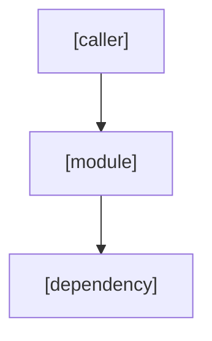
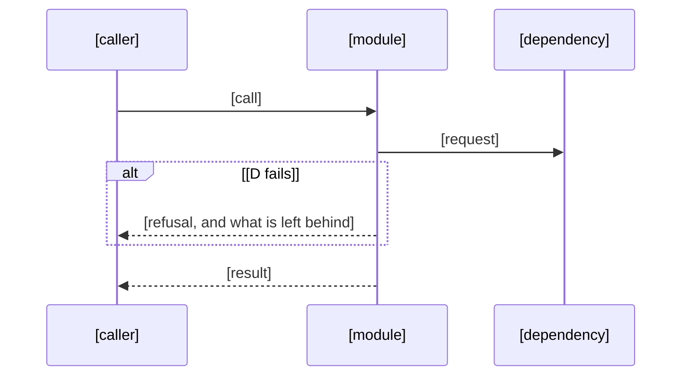

# Implementation Plan: [FEATURE]

**Spec**: `.agents/specs/sta-n-<slug>/spec.md` · **Linear**: STA-n · **Date**: [DATE]

**Input**: Feature specification from `.agents/specs/sta-n-<slug>/spec.md`

## Summary

[The primary requirement and the technical approach, in a few lines]

## Technical Context

- **Language**: TypeScript (ESM), Node 24 (`mise.toml`)
- **Members**: [pnpm + Turborepo members touched, by path, with their tier tag]
- **Testing**: vitest in `src/**/__tests__/` (ADR 0022); scripts use node:test in `tools/scripts/__tests__/`
- **Storage**: [MikroORM entities and migrations, or none]
- **Runtime target**: [the Encore app generated by `stackra gen` (ADR 0124), a library, or a script]

## Key trade-off and research

<!-- The one choice that shapes the design, the option not taken and the cost of the one taken; then what was read
     before choosing. Worked example:
     - **Trade-off: the record lives on the task's branch**, not in a central store: no service to run, and
       `--workspace` reads every repository's records; the cost is reading branches while a task is open.
     - **Research**: `tools/scripts/adr-reserve.mjs` (reservation by a PR whose loser conflicts), Flow's task
       markers from before the rename (tag `legacy-2026-10-30`), the 0.2.3 gate (`checkStage`, `parseTasks`). -->

- **Trade-off**: [the choice, the option not taken, and the cost of the one taken]
- **Research**: [the code, ADRs, prior specs and outside work read before choosing, by path or link, and what each showed]

## Applicable standards

<!-- Every rule this plan must follow, and how it is enforced: a check (the test, lint rule or gate that fails) or
     "review" (a finding the reviewer raises). Worked example rows:
     | Secrets by name only (ADR 0009)                  | check: gitleaks in CI; review: the security reviewer |
     | Tests beside their subjects in `__tests__/` (ADR 0022) | check: the repository layout in CI             | -->

| Rule                           | How it is enforced                                             |
| ------------------------------ | -------------------------------------------------------------- |
| [rule, with its ADR or source] | [check: the test, lint rule or gate / review: who raises it] |

## Constitution Check

<!-- spec-gate check (Planned) fails on a row that is not PASS or N/A, and on an N/A without a reason. -->

| Law                                   | Result | Note |
| ------------------------------------- | ------ | ---- |
| Boundaries (tier direction, ADR 0003) | PASS   |      |
| Secrets (ADR 0009)                    | PASS   |      |
| Security                              | PASS   |      |
| HTTP and events                       | PASS   |      |
| Tenancy                               | PASS   |      |
| Delegation                            | PASS   |      |
| Not built yet (ADR 0011)              | PASS   |      |
| Test placement (ADR 0022)             | PASS   |      |
| Versions and catalogs                 | PASS   |      |
| Deploy modes (ADR 0076)               | PASS   |      |
| Licence tier (ADR 0077)               | PASS   |      |
| Docs and ADRs                         | PASS   |      |

## Deploy modes

| Mode       | Behaviour |
| ---------- | --------- |
| SaaS       |           |
| On-prem    |           |
| Air-gapped |           |

## Correctness properties

<!-- One P-### per property the tests prove. Every FR is validated by a property, or marked example-only. -->

- **P-001**: [property] — Validates: FR-001

<!-- ADR 0502: for a feature or big spec plan.md is the design, and the gate requires these nine sections in this order
(write "none" under one that does not apply). The approval stop presents it to the owner as "the design". -->

## Architecture overview

[How the pieces fit: members, modules and the flow between them]

<!-- A Mermaid diagram of the dependency direction (arrows point at what is imported). Add a sequence diagram where
     order or failure timing matters (a queue, a retry, a two-step write); delete it when nothing does. -->





## Components and responsibilities

[One line on how the work divides into the components below]

<!-- Keep the line above: the gate reads it as this section's body. Then one `###` per component this adds or changes,
     with its responsibility, location, the folder tree of every file it adds or changes, the real interface
     declarations in TypeScript (names, parameters, returns, thrown errors), its behaviour (pseudocode for anything
     non-trivial) and its failure modes per dependency. A component without its folder tree or its interfaces is not
     done. Worked example:

     ### C1 Invoice numbering
     **Responsibility**: issue gap-free invoice numbers per tenant. **Location**: `services/billing/src/modules/invoice/`.
     ```text
     services/billing/src/modules/invoice/
     ├── numbering.service.ts                  (new)
     └── __tests__/numbering.service.test.ts   (new)
     ```
     ```ts
     /** @throws {NumberingConflictError} when another issue holds the tenant's row lock for 5 s */
     export function nextInvoiceNumber(tenantId: TenantId, tx: Transaction): Promise<InvoiceNumber>;
     ```
     **Behaviour**: lock the tenant's counter row; read; increment; write; return the formatted number.
     **Failure modes**: the database times out → the transaction rolls back and no number is used. -->

### C1 [Component name]

**Responsibility**: [what it owns, in one line] · **Location**: [member and folder]

```text
[member]/
├── src/[path]/[file].ts                    (new)
└── src/[path]/__tests__/[file].test.ts     (new)
```

```ts
/** [what it does] @throws [ErrorType] [when] */
export function [name]([param]: [Type]): [ReturnType];
```

**Behaviour**: [pseudocode for anything non-trivial, else one line]

**Failure modes**: [each dependency → what happens when it fails, and what is left behind]

## Files and folders

[The exact paths to add or change, by member: the component trees above, merged]

## Data models and migrations

[MikroORM entities, tables, RLS and migrations, or none]

## Contracts

[Actions and queries with their keys, events with their names and versions, exports and API, or none]

## Error handling

[Refusals and their codes, retries, what a failure leaves behind]

## Security and tenancy

[Permissions, tenant isolation, personal data, secrets by name, or none]

## Testing strategy

[Which tiers prove which acceptance criteria (AC-###), and the fixtures]

## Rollout

[Flags, migrations order, backfills, release notes, or none]

## Partial-failure ordering

[The order the parts land and run in; what a failure between two steps leaves behind, and how it is undone; or none]

## Delegation and risk plan

[Claude-only areas, expected waves, routes per task type, budget estimate]

## ADRs

[ADRs this plan relies on (must be Accepted before dependent phases merge), or drafts it opens]

## Docs

[Pages from Impact "Docs to update"]

## Complexity tracking

[Only constitution deviations, each with its justification; else "none"]

## Open questions

<!-- Approval waits until no question is open: answer each, move the answer into the spec or this plan, then
     write "None." -->

- [question, who answers it, and what it blocks]
