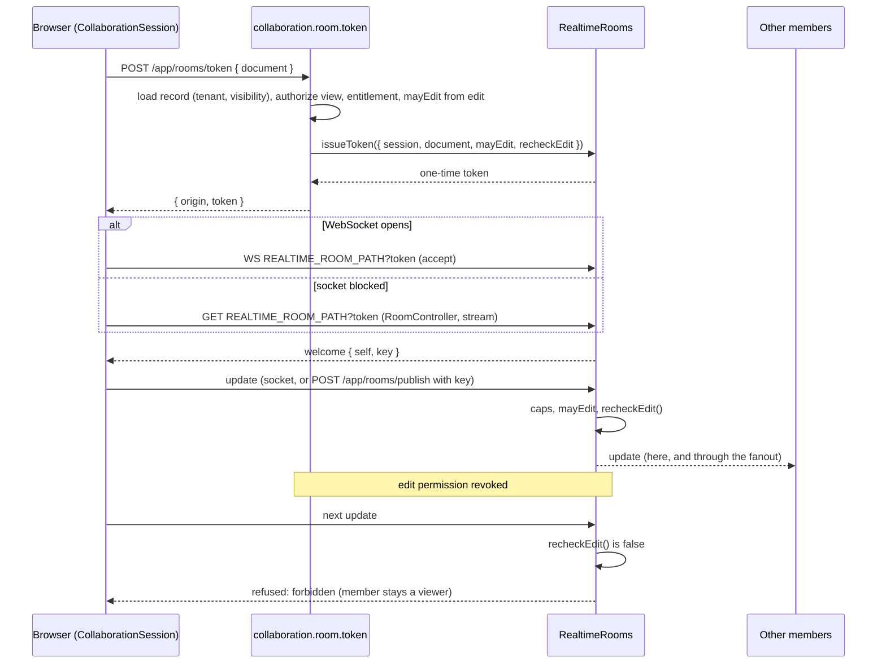

# @stackra/collaboration

Stackra collaboration: presence, cursors, the Yjs binding and snapshots for the builder's documents, and comments on
any `Commentable` record (threads, revisions, tombstones and mentions, ADR 0433). The code is free; live collaboration
is unlocked per scope by `LiveCollaborationEntitlement` (ADR 0270 decision 5, ADR 0202). Comments are core and take no
entitlement.

**Tier:** `tier:lib` (`packages/experience/collaboration`). Entries `.`, `./contracts`, `./node`, `./react` and
`./testing`. Depends on `@stackra/contracts`, `@stackra/container`, `@stackra/config`, `@stackra/validation`,
`@stackra/errors`, `@stackra/entitlements`, `@stackra/realtime`, `@stackra/database`, `@stackra/model`,
`@stackra/events`, `@stackra/actions`, `@stackra/transport`, `@stackra/app` (the room controller),
`@stackra/clients` (the client token driver) and zod. React and Yjs are optional peers for `./react`.

## What is here

| Entry         | Symbol                                                                                  | Use                                                            |
| ------------- | --------------------------------------------------------------------------------------- | -------------------------------------------------------------- |
| `.`           | `CollaborationConfig`, `CollaborationConfig$`, `CollaborationOptions`                   | key `collaboration`: cursor send interval, snapshot interval   |
| `.`           | `LiveCollaborationEntitlement`                                                          | the feature right (`collaboration.live_collaboration`)         |
| `.`           | `CollaborationSession`                                                                  | joins rooms, keeps presence, throttles cursors, binds replicas |
| `.`           | `SnapshotService`                                                                       | restores, saves and autosaves a document's state               |
| `./contracts` | `PresenceChannel`, `SyncTransport`, `SnapshotStore`                                     | the three ports a host binds                                   |
| `./contracts` | `CollaborationRoom`, `PresencePeer`, `DocumentReplica`, `DocumentSnapshot`, ...         | the types they speak; `DocumentReplica` keeps Yjs out of `.`   |
| `./react`     | `usePresence`, `useCursors`, `useSharedDocument`, `yjsReplica`                          | the hooks and the Yjs binding                                  |
| `./testing`   | `MemoryPresenceChannelDriver`, `MemorySyncTransportDriver`, `MemorySnapshotStoreDriver` | in-process drivers for tests                                   |
| `./contracts` | `MentionDirectory`, `CommentVisibility`, `MentionKind`, `ThreadStatus`                  | the mention port the consumer binds; the comment enums         |
| `./contracts` | `CommentableRef`, `MentionTarget`, `CommentRules`, `CommentView`                        | the comment types                                              |
| `.`           | `CommentCreated`, `MentionCreated`, `checkMentions`, three refusals                     | events, the mention floors, `comment_tombstoned` and others    |
| `./node`      | `CommentThread`, `Comment`, `CommentRevision`, `CommentMention`, `CommentService`       | the tables (`collaboration.0002_create_comments`) and service  |
| `./testing`   | `MemoryMentionDirectoryDriver`                                                          | a fixed set of known mention targets                           |
| `./node`      | `RoomPublishAction`, `RoomPublishInput`, `RoomPermissions`                              | `collaboration.room.publish`: a stream member's messages       |
| `./node`      | `Collaborative`, `CollaborativeOptions`                                                 | the model facet: a model's records have rooms                  |
| `./node`      | `RoomTokenAction`, `RoomTokenInput`, `RoomTokenOutput`                                  | `collaboration.room.token`: the checked one-time room token    |
| `./node`      | `RoomController`, `CollaborationModule`                                                 | the room stream at `REALTIME_ROOM_PATH`; the root module       |
| `./node`      | `RoomMemberRole`                                                                        | grants `collaboration.room.token` and `.publish`               |
| `.`           | `ClientRoomTokensDriver`                                                                | `RoomTokens` over the app's `DynamicClient` (driver `client`)  |

## Comments

```ts
const comment = await comments.post(
  ctx.scope,
  { record: { model: "legal.matter", id }, body, visibility, mentions, isExternalAuthor },
  actor.id,
  { sharedComments: settings.sharedComments, assistantHandle: settings.assistantHandle }, // tenant settings
);
await comments.edit(comment.id, body, mentions, actor.id, rules); // keeps a revision, announces added mentions only
await comments.tombstone(comment.id, actor.id); // text hidden, mentions dropped; refused under a legal hold
await comments.resolveThread(comment.threadId, actor.id); // a reply reopens it
```

The floors are code: an external author never posts internal, an external participant is never mentioned on an
internal comment, the assistant is not mentioned while it has no handle, a tombstone shows no text. Defaults (the level
a comment takes, whether sharing is open, the handle) are the consumer's settings; who may edit or delete is its
policy.

## Collaboration levels

ADR 0270 decision 6 sets the level per document kind:

| Level          | Kinds                                       | Use                                         |
| -------------- | ------------------------------------------- | ------------------------------------------- |
| full           | page, screen, app shell, post, article      | `useSharedDocument` + `useCursors`          |
| presence + OCC | form, dashboard, email template, automation | `usePresence`; saves keep the version check |
| OCC            | navigation, pricing rules                   | nothing from this package                   |

```tsx
const room = { document: page.id, scope };
const doc = useSharedDocument(room); // a Y.Doc: restored, co-edited, autosaved
const presence = usePresence(room); // { status, peers }
const [cursors, moveCursor] = useCursors(room);
```

A room is keyed by its document's public id and scoped by a `ScopeRef`. The grant of `LiveCollaborationEntitlement`
is read for that scope when the room is first held. Without it, `usePresence` throws `EntitlementRequiredError` to the
nearest error boundary, and `useSharedDocument` still restores and saves the document, alone: editing and snapshots are
never gated.

## Snapshots

`SnapshotService.track` saves the full state at most once per `snapshotIntervalSeconds` after a local change, and once
more when the editor closes. Only the client that made a change saves it. Autosave starts only after the restore
succeeded, so a failed load never overwrites the saved state. Retention is the `SnapshotStore` driver's: keeping the
latest is enough, because versions, drafts and publishing are the content type's (ADR 0270 decision 2).

## Not a sync engine

Yjs is the CRDT for shared documents only. A `SyncTransport` relays live updates of one open document; on every open
the replica sends its full state, so a reconnect converges. There is no offline queue and no record sync (ADR 0227).

## Testing

```ts
const presence = MemoryPresenceChannelDriver.for("usr_…");
const sync = new MemorySyncTransportDriver();
const session = new CollaborationSession(
  config,
  presence,
  sync,
  fakeEntitlements([[LiveCollaborationEntitlement, true]]),
);
const other = new CollaborationSession(config, presence.peer("usr_…"), sync.peer(), source);
presence.drop(); // the link goes down; presence.reconnect() brings it back
```

## Hosting rooms

A service hosts rooms by declaring `@stackra/collaboration` (with `@stackra/realtime`) and marking each model whose
records are co-edited:

```ts
// src/modules/studio/models/template.model.ts
@Collaborative({ view: TemplatePermissions.read, edit: TemplatePermissions.update })
export class Template extends Model.with(HasPublicId("tpl"), BelongsToTenant) {}
```

Gen wires the rest from the package's root module (`CollaborationModule`), with no hand code in the service:

- `collaboration.room.token@1` (`RoomTokenAction`, `POST /app/rooms/token`, users only, not a tool, permission
  `collaboration.room.token`, L2). Its input is the document's public id; the prefix names the `@Collaborative` model.
  It reads the record through its repository in the caller's tenant (row security and visibility: an unknown, another
  tenant's or an invisible document is `not_found`), checks the model's `view` permission on it through `AccessControl`
  as `ctx.authorize(record)` does (`forbidden`), requires `LiveCollaborationEntitlement` for the scope
  (`entitlement_required`), sets `mayEdit` from the model's `edit` permission and answers the `RealtimeTarget` (the
  `realtime.origin` config and a one-time token from `RealtimeRooms.issueToken`, bound to the document and the caller).
- `collaboration.room.publish@1` (`POST /app/rooms/publish`), the stream member's send.
- `RoomController` at `REALTIME_ROOM_PATH`: a GET is the room's server-sent-events stream (`RealtimeRooms.stream`).
- Revocation: the grant carries `recheckEdit`, so the room asks the edit permission again before relaying each
  `update`. Once it is refused (or the check fails) the member's update is answered `refused: forbidden` and the member
  stays a viewer; viewing ends at the latest when the token's lifetime (`realtime.subscribeTokenTtl`) closes the link.

Both room permissions are L2, so a member needs them granted on top of the model's view (and edit) permission: assign
the shipped module role `RoomMemberRole` (`collaboration.room_member`, `./node`), or list the two keys in a custom role.
An owner holds them through the wildcard.

A browser or native host binds `RoomTokens` to `ClientRoomTokensDriver` (driver `client`): it calls the two actions by
key and route through the app's `DynamicClient`. When the hosting service is not behind the one API URL, set
`clients.producers.collaboration` to its base URL.



## Network drivers

- `RealtimePresenceChannelDriver` and `RealtimeSyncTransportDriver` (`.`) ride the document's `@stackra/realtime` room
  (ADR 0346). Before each connect they ask the `RoomTokens` port (`./contracts`) for a one-time token; the host binds it
  over its generated client's room-token action. Presence is re-announced every `presenceHeartbeatSeconds`, cursors
  are throttled to `cursorIntervalMilliseconds`, and updates travel as base64 `update` messages.
- When the room's socket closes before it ever opened (a proxy or network that blocks WebSockets), the link streams
  the room over server-sent events (`GET REALTIME_ROOM_PATH`, served by `RealtimeRooms.stream`) for the rest of its
  life and sends through `RoomTokens.publish` with the publish key of its `welcome`. The host overrides `publish` over
  its generated client's `collaboration.room.publish`; the default rejects, so such a link only listens.
- `RoomPublishAction` (`./node`, `collaboration.room.publish@1`, users only, not a tool) relays one message as the
  member whose key it is (`RealtimeRooms.publishFrom`), only for that member's own principal and with the checks a
  socket message gets: a viewer's `update` is refused `forbidden`, the size and rate caps drop the member. The service
  that serves rooms hosts it. Its permission is `collaboration.room.publish` (`RoomPermissions`, L2).
- `PostgresSnapshotStoreDriver` (`./node`) keeps the latest state per document in `collaboration.snapshots`
  (migration `collaboration.0001_create_snapshots`), isolated by the room's scope.

## Limits today

- A stream member's publish that reaches another instance is fire-and-forget: a refusal arrives on the member's own
  stream as a `refused` frame, not as the action's answer.
- The generated Encore adapter cannot upgrade a socket: `RoomController` answers a WebSocket upgrade 426 and the link
  falls back to the event stream with the same token. A runtime that upgrades sockets calls `RealtimeRooms.accept`.
- The edit re-check reads the policy for every relayed update; the record is the one loaded at token time, so a policy
  that reads the record's fields sees them as they were then.
